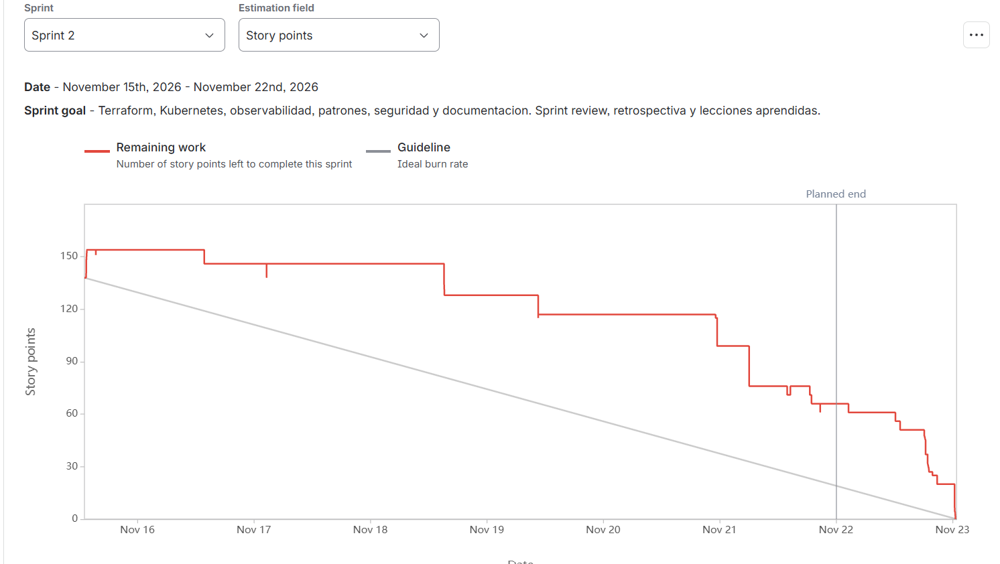
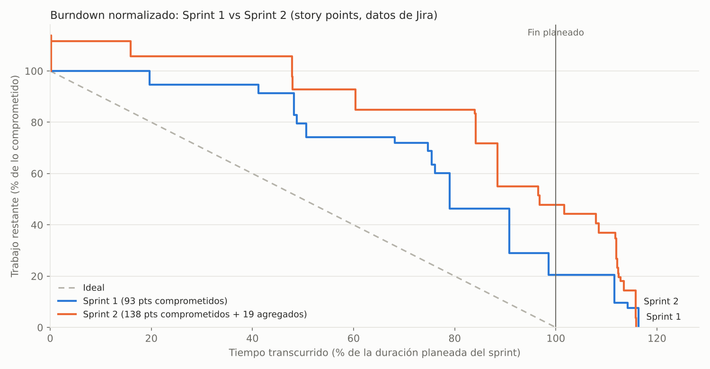

# Sprint 2: planeación, review, retrospectiva y métricas

**Proyecto:** CircleGuard\
**Periodo en Jira:** 15 de noviembre (13:06) al 22 de noviembre de 2026 (fin planeado); cerrado el
23 de noviembre a las 00:51 (hora de Bogotá)\
**Marco de trabajo:** Scrum\
**Tablero:** Jira, proyecto `CGR`, *SCRUM board* (<https://circleguard.atlassian.net>)

Las cifras de este documento salen de Jira el 23 de noviembre de 2026: story points (campo *Story
point estimate*) y fecha de resolución de cada historia. Se cuentan solo las historias de usuario;
las épicas no tienen estimación. Los datos y el script que dibuja el burndown están en
[`metricas/burndown.py`](metricas/burndown.py).

## 1. Planeación

### 1.1. Objetivo

**Objetivo (Jira):** *"Terraform, Kubernetes, observabilidad, patrones, seguridad y documentación.
Sprint review, retrospectiva y lecciones aprendidas."*

En la planeación de los sprints 0 y 1 se había previsto que el Sprint 2 empezara el 8 de noviembre.
En Jira empezó el 15 de noviembre, porque el Sprint 1 siguió abierto hasta el 16 (sección 4). Parte
del trabajo de Terraform y de patrones se adelantó en esa semana, pero se registró en este sprint.

### 1.2. Compromiso

| Épica | Historias | Puntos | Responsables |
|:---|:---|---:|:---|
| IaC con Terraform (CGR-14) | HU-26, HU-27, HU-28 | 16 | Johan |
| Orquestación en Kubernetes (CGR-15) | HU-29, HU-30, HU-31 | 23 | Ismael |
| Pipeline incrementado (CGR-16) | HU-32, HU-33, HU-34 | 13 | Johan, Jean, Ismael |
| Patrones de diseño (CGR-17) | HU-35, HU-36, HU-37, HU-38 | 15 | David, Jean, Johan |
| Observabilidad (CGR-18) | HU-39, HU-40, HU-41, HU-42, HU-43 | 26 | David, Jean |
| Seguridad (CGR-19) | HU-44, HU-45, HU-46, HU-47 | 13 | Jean |
| Pruebas avanzadas (CGR-20) | HU-48, HU-49, HU-50 | 10 | Jean |
| Change management avanzado (CGR-21) | HU-51, HU-52 | 5 | David, Ismael |
| Documentación completa (CGR-22) | HU-53, HU-54, HU-55, HU-56, HU-57 | 17 | David, Johan, Ismael |
| **Total comprometido** | **32 HU** | **138** | |

**Alcance agregado ya iniciado el sprint.** El 15 de noviembre, unos 20 minutos después de iniciar
el sprint, entraron tres historias del pipeline: HU-58 (release candidate en el PR de promoción,
8 pts), HU-59 (promoción del RC a versión estable, 8 pts) y HU-60 (pipeline que falla rápido,
3 pts). Son 19 puntos más, un 14 % sobre lo comprometido. El sprint terminó con **35 HU y
157 puntos**.

**Reparto por integrante.** En el Sprint 1 se acordó compensar en este sprint la llegada tardía de
Jean. Así quedó:

| Integrante | HU | Puntos | Parte del total |
|:---|---:|---:|---:|
| Jean Carlo Ocampo | 12 | 47 | 30 % |
| David Chicué | 10 | 43 | 27 % |
| Johan Suarez | 6 | 31 | 20 % |
| Ismael Barrionuevo | 6 | 31 | 20 % |
| Sin asignar (HU-56, sustentación) | 1 | 5 | 3 % |

HU-57 (bitácora de IAG e informe PDF de la Parte 2) no tiene estimación en Jira.

**Dependencias acordadas.**
- Kubernetes (HU-29 a HU-31) dependía de los módulos de Terraform (HU-26 y HU-27), que crean los
  clústeres.
- El despliegue gobernado por el pipeline (HU-34) dependía de los dos anteriores.
- La observabilidad (HU-39 a HU-41) dependía del chart de Kubernetes, que expone las métricas.
- La documentación (HU-53 a HU-57) se dejó al final, porque describe lo que quedara desplegado.

## 2. Review

### 2.1. Resultado por épica

| Épica | Resultado | Evidencia |
|:---|:---|:---|
| IaC con Terraform | Módulos reutilizables (red, clúster, registro, almacenamiento y observabilidad), tres ambientes parametrizados y estado remoto en S3 con bloqueo en DynamoDB | [`../arquitectura/infraestructura.md`](../arquitectura/infraestructura.md), `infra/terraform/` |
| Kubernetes | Un clúster k3s por ambiente con un chart de Helm: los 8 servicios, el cliente web y el middleware; ConfigMaps, Sealed Secrets, Ingress, sondas y HPA | [`../arquitectura/kubernetes.md`](../arquitectura/kubernetes.md), `deploy/k8s/` |
| Pipeline incrementado | `terraform plan/apply` en el pipeline con aprobación para prod, Trivy bloqueante en imágenes e IaC, y despliegue y promoción a Kubernetes desde Jenkins | [`../operaciones/jenkins-pipeline.md`](../operaciones/jenkins-pipeline.md) |
| Patrones | Catálogo de 17 patrones existentes, más tres nuevos: circuit breaker y retry con Resilience4j, configuración externa con feature toggle, y transactional outbox | [`../patrones/existentes.md`](../patrones/existentes.md) |
| Observabilidad | Métricas con Micrometer y Prometheus, paneles técnicos y de negocio en Grafana, alertas de Alertmanager a Discord probadas una por una, trazas de Jaeger a través de Kafka y logs en Loki | [`../arquitectura/observabilidad.md`](../arquitectura/observabilidad.md) |
| Seguridad | Escaneo continuo de dependencias e imágenes, secretos fuera del repositorio con Sealed Secrets, RBAC en Kubernetes y Jenkins, y TLS con cert-manager. RBAC y TLS están en `dev` y llegan a stage y prod con la versión `0.8.0` | [`../arquitectura/seguridad.md`](../arquitectura/seguridad.md), [`../operaciones/tls.md`](../operaciones/tls.md) |
| Pruebas avanzadas | Carga y estrés con Locust, ZAP baseline en el pipeline e informe consolidado de cobertura y calidad | [`../operaciones/informe-pruebas.md`](../operaciones/informe-pruebas.md) |
| Change management | Release notes por versión y registro de despliegues por ambiente (GitHub Deployments y `registro-ambientes.md`); plan de rollback ejecutado en Kubernetes | [`../release-notes/trazabilidad.md`](../release-notes/trazabilidad.md), [`../operaciones/rollback.md`](../operaciones/rollback.md) |
| Alcance agregado (HU-58 y HU-59 en *Entrega continua y promoción*, CGR-10; HU-60 en *Pipeline incrementado*) | Release candidate en el PR de promoción, promoción del RC a versión estable sin reconstruir, y pipeline que falla rápido | [`../release-notes/etiquetado.md`](../release-notes/etiquetado.md) |
| Documentación | Documentación técnica comparada contra los clústeres y los estados de Terraform; costos, manual de operaciones y resumen ejecutivo en inglés | [`../README.md`](../README.md), [`../arquitectura/coherencia.md`](../arquitectura/coherencia.md), [`../costos/README.md`](../costos/README.md) |

**Resultado:** las 35 historias quedaron en *Finalizado*, y el objetivo se cumplió. Pero solo el
58 % de los puntos estaba resuelto en la fecha de fin planeada, y el resto se cerró en las 25 horas
siguientes (sección 3).

### 2.2. Trabajo que pasa al Sprint 3

- **file-service:** los archivos ya se guardan en el bucket S3 del ambiente, con el rol del nodo.
  Falta desplegarlo con la versión siguiente.
- **Service mesh:** Linkerd con mTLS en los tres ambientes, y canary de `gateway` con Flagger en dev
  y stage ([`../arquitectura/service-mesh.md`](../arquitectura/service-mesh.md)). Ya está
  instalado; faltan el release que activa la malla en los pods y las pruebas de promoción y
  reversión.
- **Chaos engineering:** sin iniciar.

## 3. Métricas: Sprint 1 frente a Sprint 2

### 3.1. Burndown del Sprint 2 en Jira

### 3.2. Comparación normalizada

Los dos sprints duraron distinto (5 y 6,5 días) y comprometieron distintos puntos (93 y 138). Por
eso la gráfica los pone en la misma escala:
- **Eje horizontal:** porcentaje de la duración planeada del sprint.
- **Eje vertical:** porcentaje de los puntos comprometidos que falta. Si sube de 100 %, es alcance
  agregado.

| Métrica | Sprint 1 | Sprint 2 | Cambio |
|:---|---:|---:|:---|
| Duración planeada | 5,0 días | 6,5 días | |
| HU completadas / comprometidas | 21 / 21 | 35 / 32 (+3 agregadas) | Más alcance, todo entregado |
| Puntos completados | 93 | 157 | +69 % |
| Velocidad (puntos por día planeado) | 18,4 | 24,3 | +32 % |
| Alcance agregado ya iniciado el sprint | 0 pts | 19 pts (14 %) | Empeoró |
| Puntos resueltos al fin planeado | 74 (80 %) | 91 (58 %) | Empeoró |
| Puntos resueltos después del fin planeado | 19 (20 %) | 66 (42 %) | Empeoró |
| Retraso del cierre del sprint en Jira | 8,5 días | 1,0 día | Mejoró |
| HU cerradas en lote (en el mismo minuto que otra) | 10 de 21 (48 %) | 22 de 35 (63 %) | Empeoró |
| Días sin ninguna HU cerrada | 1 (4 nov) | 1 (17 nov) | Igual |
| Parte del sprint que lideró Jean | 2 HU, 12 % de los puntos | 12 HU, 30 % de los puntos | Compensación cumplida |

### 3.3. Análisis

**Qué mejoró:**

- **Capacidad.** El equipo entregó 157 puntos en 6,5 días planeados, frente a 93 en 5. Es un 32 %
  más de puntos por día, ya con cuatro integrantes desde el inicio del sprint. Ayudó que la Shared
  Library y la ejecución selectiva del Sprint 1 permitieran trabajar en paralelo sin chocar en el
  `Jenkinsfile`.
- **Cierre del sprint.** El Sprint 1 quedó abierto 8,5 días después de su fin planeado y retrasó el
  inicio del Sprint 2. El Sprint 2 se cerró un día después, con todas las historias finalizadas y sin
  pasar nada al siguiente sprint.
- **Reparto.** Jean pasó de liderar el 12 % de los puntos a liderar el 30 %, como se acordó en la
  retrospectiva anterior. Cerró 31 de sus 47 puntos antes del fin planeado.

**Qué no mejoró:**

- **El burndown se queda por encima de la guía todo el sprint.** A mitad del sprint se había resuelto
  el 18 % de los puntos, frente al 20 % del Sprint 1. Las épicas de
  infraestructura tienen dependencias en cadena (Terraform → Kubernetes → despliegue →
  observabilidad), y las historias de abajo de la cadena no podían cerrarse antes que las de arriba.
- **Mucho trabajo al final.** El 42 % de los puntos se resolvió después del fin planeado, frente al
  20 % del Sprint 1. La documentación (17 puntos) estaba planeada para el final por diseño, y además
  hubo problemas de infraestructura que solo aparecieron al integrar en los clústeres reales:
  - el webhook de Discord con un BOM, que impedía enviar las alertas;
  - permisos de IAM que faltaban al usuario de Terraform del pipeline;
  - el límite de memoria de los nodos de 8 GB.
- **Jira se actualiza en lote.** El 63 % de las historias se cerró en el mismo minuto que otra (por
  ejemplo, HU-29, HU-30 y HU-31 a las 06:05 del 21 de noviembre). El burndown baja en escalones
  grandes y no muestra el avance real día a día. Esto incumple la acción del Sprint 1 de "actualizar
  Jira en el momento en que se abre o se fusiona el PR".
- **Alcance agregado ya iniciado el sprint.** HU-58, HU-59 y HU-60 entraron después del inicio
  (19 puntos). Eran necesarias para la promoción de releases, pero debieron entrar en la planeación.

## 4. Retrospectiva

### 4.1. Seguimiento de las acciones del Sprint 1

| Acción del Sprint 1 | Resultado en el Sprint 2 |
|:---|:---|
| Agrupar los cambios de un tema en una rama y un PR | **Parcial.** Se agrupó por tema, pero varios PR pasaron la política de tamaño (700 / 300 líneas) y hubo que dividirlos después de abiertos |
| Probar en Jenkins cada cambio de configuración antes de pedir revisión | **Parcial.** Los cambios de Terraform con IAM fallaron en el PR por permisos del usuario del pipeline, que no se habían revisado antes |
| Actualizar Jira al abrir o fusionar el PR | **No se cumplió.** 22 de 35 historias se cerraron en lote |
| Dejar la documentación dentro de la HU que hace el cambio | **Cumplido.** Cada HU de infraestructura actualizó sus docs, y HU-54 las comparó contra los clústeres |
| Registrar el uso de IA en cada sesión | Se consolidó en HU-57 al cierre del sprint |
| Repartir la carga de las HU que lidera Jean | **Cumplido.** 12 HU y 47 puntos liderados por Jean, con apoyo del equipo en las de seguridad y pruebas |

### 4.2. Qué salió bien

- **Infraestructura reproducible de punta a punta.** Terraform crea la red, los clústeres, el
  registro, el bucket y el monitoreo de cada ambiente, y el pipeline aplica los cambios con
  aprobación para prod.
- **Alertas probadas de verdad.** Cada alerta se provocó a propósito y se comprobó que llegara a
  Discord, en vez de dar por buena la configuración.
- **Documentación auditada.** La documentación técnica se comparó contra los clústeres y los estados
  de Terraform (HU-54), y se corrigió lo que no coincidía.
- **Releases trazables.** Release candidate en el PR de promoción, release notes por versión y
  registro de despliegues por ambiente.
- **Reparto equilibrado.** Ningún integrante lideró más del 30 % de los puntos.

### 4.3. Qué salió mal

- **El Sprint 1 se cerró tarde en Jira**, y el Sprint 2 empezó una semana después de lo planeado.
  El trabajo hecho en esa semana no aparece en el burndown de ningún sprint.
- **Los problemas de los clústeres se descubrieron al final.** El BOM del webhook, los permisos de
  IAM y la memoria de los nodos aparecieron al integrar, el último día. Prod tiene ~1,1 GB libres,
  y eso limitó lo que se puede desplegar allí (por ejemplo, el canary de Flagger).
- **El tablero no refleja el día a día**, por los cierres en lote.
- **PR divididos después de abiertos** por la política de tamaño, y commits rechazados por
  `commitlint` por pasar de 72 caracteres. Fueron rondas extra de CI.
- **Alcance agregado ya iniciado el sprint** sin reducir otro alcance.

### 4.4. Acciones de mejora

Cada acción tiene un responsable sugerido según su área, que el equipo confirma en la planeación
del siguiente sprint.

| Acción | Responsable sugerido | Cómo se mide |
|:---|:---|:---|
| Cerrar el sprint en Jira el mismo día de su fin planeado y abrir el siguiente en la planeación | David (tablero) | Retraso de cierre ≤ 1 día |
| Mover cada HU en Jira dentro de la misma hora en que se fusiona su PR | Cada responsable de HU | Menos del 25 % de cierres en lote |
| Partir en historias más chicas (≤ 5 puntos) las que están al inicio de una cadena de dependencias | Johan e Ismael (infraestructura) | ≥ 40 % de los puntos resueltos a mitad del sprint |
| Probar contra un clúster real (dev) antes de la mitad del sprint los cambios que tocan IAM, secretos o memoria | Ismael (despliegue) | Ningún fallo de permisos ni de secretos en el PR |
| Revisar los permisos del usuario `circleguard-terraform-ci` en el mismo PR que agrega recursos de IAM | Johan (Terraform) | Plan del PR en verde a la primera |
| Estimar el tamaño del PR en la planeación y dividir antes de abrirlo | Cada responsable de HU | Ningún PR rechazado por tamaño |
| Toda historia nueva entra en la planeación; si entra ya iniciado el sprint, sale otra de igual tamaño | Equipo | Alcance agregado ≤ 5 % |
| Medir la memoria libre de cada nodo antes de comprometer componentes nuevos | Ismael | Ningún componente descartado en prod por memoria al final del sprint |

## 5. Lecciones aprendidas

1. **Un burndown en escalones dice más del tablero que del equipo.** Si Jira no se actualiza al
   fusionar, la métrica pierde valor para tomar decisiones a mitad del sprint.
2. **En infraestructura, las dependencias marcan el ritmo.** Las historias de abajo de la cadena
   (Kubernetes, despliegue, observabilidad) no pueden empezar antes, así que la de arriba tiene que
   cerrarse pronto y en partes chicas.
3. **El entorno real descubre lo que la revisión no ve.** Un BOM en un secreto, un permiso de IAM o
   el límite de memoria de un nodo solo aparecen al aplicar en el clúster. Probar ahí temprano es
   más barato que corregir el último día.
4. **Cerrar a tiempo el sprint anterior es parte del sprint siguiente.** Los 8,5 días de retraso del
   Sprint 1 recortaron una semana del Sprint 2.
5. **La documentación verificada contra lo desplegado encuentra errores reales.** La revisión
   cruzada de HU-54 corrigió IPs, puertos y versiones que habían cambiado.
