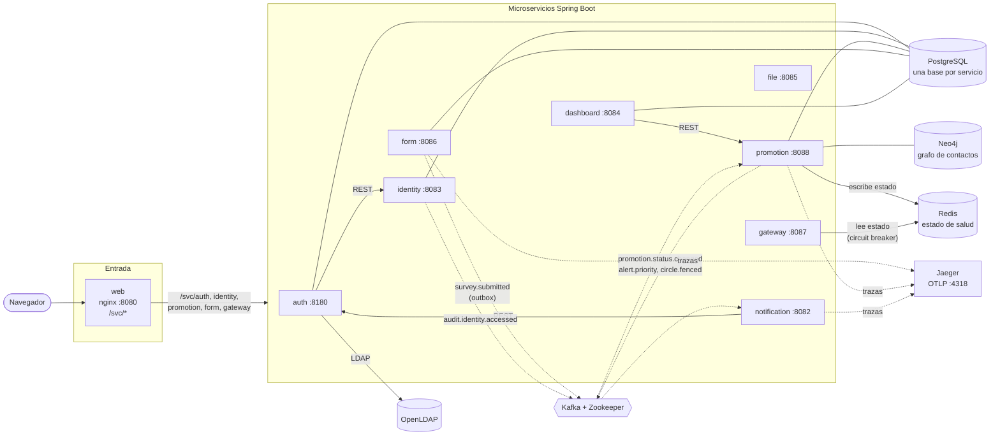
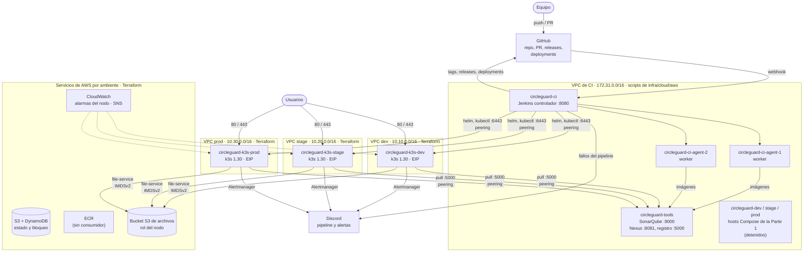
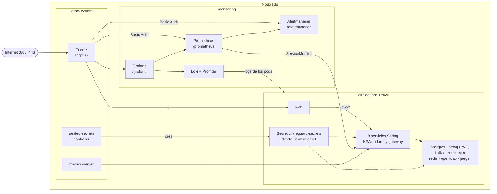
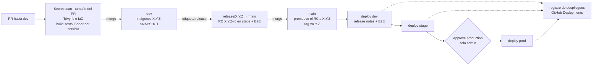

# Arquitectura de CircleGuard

Cómo está construida y desplegada la solución. Lo que se describe aquí se comparó con los tres
clústeres, los estados de Terraform y las instancias de AWS el 22 de noviembre de 2026, con la
versión `0.7.0` desplegada en `dev`, `stage` y `prod`. El resultado de esa comparación está en
[`coherencia.md`](coherencia.md).

| Tema | Documento |
|:---|:---|
| Infraestructura como código (Terraform) | [`infraestructura.md`](infraestructura.md) |
| Kubernetes (k3s y chart de Helm) | [`kubernetes.md`](kubernetes.md) |
| Observabilidad | [`observabilidad.md`](observabilidad.md) |
| Seguridad | [`seguridad.md`](seguridad.md) |
| Service mesh (Linkerd y canary con Flagger) | [`service-mesh.md`](service-mesh.md) |
| Patrones de diseño | [`../patrones/existentes.md`](../patrones/existentes.md) |
| Revisión cruzada con lo desplegado | [`coherencia.md`](coherencia.md) |

Los PDFs de esta carpeta (`circleguard_deployment.pdf`, `pipeline_flow.pdf`) son los diagramas de
la Parte 1. Describen el despliegue con Docker Compose por SSH en un host por ambiente y un solo
servidor de CI. Se conservan como historia; los diagramas vigentes son los de este documento.

## 1. Vista lógica

Ocho microservicios Spring Boot 3 (Java 21), un cliente web Expo servido por nginx y el middleware
de datos y mensajería. El nginx del cliente web es el único punto de entrada: sirve la aplicación y
reenvía `/svc/<servicio>/` a cada microservicio. Las flechas continuas son llamadas síncronas; las
punteadas, eventos de Kafka.

| Componente | Responsabilidad | Datos |
|:---|:---|:---|
| `auth` | Login LDAP con respaldo local, JWT y QR firmado de acceso | `circleguard_auth` |
| `identity` | Bóveda de identidad: seudónimos con sal y cifrado | `circleguard_identity` |
| `promotion` | Máquina de estados de salud y cercos sobre el grafo de contactos | `circleguard_promotion`, Neo4j, Redis |
| `form` | Cuestionarios de salud; publica eventos con transactional outbox | `circleguard_form` |
| `notification` | Despacho multicanal de avisos a partir de eventos | — |
| `dashboard` | Analítica de focos con k-anonimato | `circleguard_dashboard` |
| `gateway` | Validación del QR en la entrada del campus | Redis (lectura) |
| `file` | Subida y descarga de certificados y documentos | Bucket S3 del ambiente, con el rol del nodo |
| `web` | Cliente web y reverse proxy | — |

`file` guarda los archivos en el bucket S3 del ambiente con el rol de IAM del nodo, sin llaves
(entra con la próxima versión; la `0.7.0` todavía los deja en un `emptyDir` del pod). Sin bucket
configurado, como en Docker Compose, los guarda en el disco local.

El detalle de cada patrón (database-per-service, eventos, cache-aside, máquina de estados,
seudonimización, circuit breaker, configuración externa, outbox) y su evidencia en el código está en
[`../patrones/existentes.md`](../patrones/existentes.md).

## 2. Vista de despliegue en AWS

Todo corre en `us-east-1`, en instancias `m7i-flex.large` (2 vCPU, 8 GB). Hay dos grupos:

- **CI**, en la VPC por defecto (`172.31.0.0/16`), creado con los scripts de
  `infra/cloud/aws/` y Docker Compose: Jenkins (controlador y dos workers), SonarQube y Nexus.
- **Ambientes**, uno por VPC, creados con Terraform: un clúster k3s de un nodo con Elastic IP.

Cada VPC de ambiente tiene un peering con la VPC de CI. Por ahí Jenkins llega al API server
(6443) y al SSH del nodo, y el nodo descarga las imágenes del registro de Nexus (`5000`) por IP
privada.

| Host | Rol | Red | Lo crea |
|:---|:---|:---|:---|
| `circleguard-ci` | Jenkins controlador (orquesta, despliega, aprueba) y caché de Gradle | VPC de CI, Elastic IP | `provision-ci-hosts.sh` + `infra/compose/ci` |
| `circleguard-ci-agent-1`, `-2` | Workers de Jenkins (compilan, prueban, publican) | VPC de CI | `provision-ci-hosts.sh` (`CI_AGENT_COUNT`) + `infra/compose/ci-agent` |
| `circleguard-tools` | SonarQube, Nexus y registro Docker | VPC de CI | `provision-ci-hosts.sh` + `bootstrap-all.sh` (`CI_ROLE=tools`) |
| `circleguard-k3s-<env>` | Clúster k3s del ambiente | VPC propia, Elastic IP | Terraform, `infra/terraform/envs/<env>` |
| `circleguard-dev`, `-stage`, `-prod` | Ambientes Compose de la Parte 1 | VPC de CI | `provision-env-hosts.sh`; detenidos, no reciben despliegues |

## 3. Dentro de un clúster

Los tres clústeres son iguales; cambian el tamaño de los discos y las réplicas mínimas del HPA
(ver [`kubernetes.md`](kubernetes.md)).

## 4. Flujo de entrega

El `Jenkinsfile` construye solo lo que cambió y promueve la misma imagen por los tres ambientes. El
detalle de cada etapa está en [`../operaciones/jenkins-pipeline.md`](../operaciones/jenkins-pipeline.md).

Cada despliegue usa `helm upgrade --atomic --wait`: si un rollout no termina, Helm vuelve a la
revisión anterior. El rollback manual es el job `circleguard-rollback`
([`../operaciones/rollback.md`](../operaciones/rollback.md)).

## 5. Decisiones y límites

| Decisión | Por qué | Costo |
|:---|:---|:---|
| Un clúster k3s de un nodo por ambiente | Aislamiento completo entre ambientes dentro del plan gratuito de AWS | Sin alta disponibilidad: si el nodo cae, cae el ambiente |
| Middleware dentro del clúster | Un solo chart levanta el ambiente completo, sin servicios gestionados | Datos en `local-path` del nodo; respaldos manuales |
| Imágenes en Nexus, no en ECR | Nexus ya existía en la Parte 1 y el peering da acceso privado | El módulo `registry` crea repositorios ECR que no se usan |
| Hosts de CI fuera de Terraform | Se crearon en la Parte 1 con scripts idempotentes | Terraform solo los lee (`data`) para el peering |
| TLS con CA de laboratorio (en `dev`, entra con la versión `0.8.0`) | No hay dominio propio y `sslip.io` choca con el límite de Let's Encrypt | El navegador no confía en el certificado sin instalar la CA; hoy el Ingress sirve HTTP |

El resumen ejecutivo y los próximos pasos están en [`../executive-summary.md`](../executive-summary.md).
