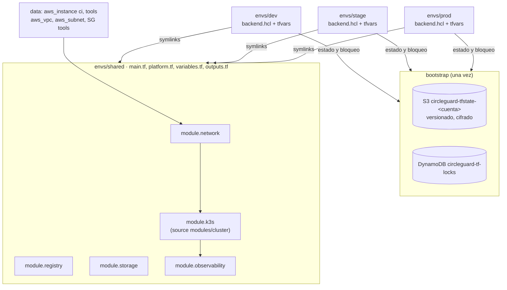

# Infraestructura como código

Qué parte de la infraestructura se declara en Terraform, qué parte se crea con scripts y qué hay
en cada estado. El código y su uso están en [`infra/terraform/README.md`](../../infra/terraform/README.md);
este documento resume la estructura y lo contrasta con lo aplicado. Inventario del 22 de
noviembre de 2026 (`terraform state list` de cada root).

## Qué se declara y cómo

| Pieza | Herramienta | Dónde | Estado |
|:---|:---|:---|:---|
| Bucket del estado y tabla de bloqueo | Terraform | `infra/terraform/bootstrap` | `circleguard-tfstate-<cuenta>` (S3) y `circleguard-tf-locks` (DynamoDB) |
| VPC, nodo k3s y servicios de AWS de cada ambiente | Terraform | `infra/terraform/envs/{dev,stage,prod}` | Una clave de estado por ambiente en el mismo bucket |
| Stack de monitoreo en el clúster | Terraform (`terraform_data` + Helm por SSH) | `modules/observability` | En el estado de cada ambiente |
| Hosts de CI (`ci`, `ci-agent-1`, `ci-agent-2`, `tools`) | Bash + AWS CLI, idempotente | `infra/cloud/aws/provision-ci-hosts.sh` | Fuera de Terraform; los roots solo los leen con `data` |
| Jenkins, SonarQube, Nexus | Docker Compose + JCasC | `infra/compose/ci`, `infra/compose/ci-agent`, `infra/bootstrap` | Fuera de Terraform |
| Hosts Compose de la Parte 1 (`circleguard-dev`, `-stage`, `-prod`) | Bash + AWS CLI | `infra/cloud/aws/provision-env-hosts.sh` | Detenidos; ya no reciben despliegues |
| Aplicación en el clúster | Helm | `deploy/k8s/circleguard` | Release `circleguard` en `circleguard-<env>` |
| Reglas de SSH y 6443 por integrante | `infra/cloud/aws/hosts.sh allow` | Security Group del nodo | Fuera del estado a propósito: Terraform declara reglas sueltas para no borrarlas |

## Estructura



Los tres roots enlazan los mismos `.tf` de `envs/shared/`; lo único propio de cada ambiente es
`backend.hcl` (la clave del estado) y `terraform.tfvars`. El bloque del nodo se llama
`module.k3s` aunque su `source` sea `modules/cluster`: se renombró el módulo sin mover el estado.

## Módulos

| Módulo | Crea | Recursos por ambiente |
|:---|:---|---:|
| [`network`](../../infra/terraform/modules/network/README.md) | VPC, subred pública, IGW, tabla de rutas, peering con la VPC de CI, ruta de CI al ambiente, Security Group del nodo con reglas sueltas (80 y 443 públicos; 22 y 6443 desde Jenkins) y una regla en el Security Group de `tools` que abre el `5000` a la VPC del ambiente | 14 |
| [`cluster`](../../infra/terraform/modules/cluster/README.md) | EC2 `m7i-flex.large`, disco gp3 cifrado, IMDSv2 con hop limit 2, Elastic IP; k3s y `registries.yaml` por `user_data`; rol de IAM del nodo con acceso solo al bucket del ambiente (rol, política e instance profile) | 6 |
| [`registry`](../../infra/terraform/modules/registry/README.md) | Un repositorio ECR por servicio con lifecycle | 16 |
| [`storage`](../../infra/terraform/modules/storage/README.md) | Bucket S3 privado, versionado, cifrado, con lifecycle | 6 |
| [`observability`](../../infra/terraform/modules/observability/README.md) | Log group de CloudWatch por servicio, alarmas de CPU y de status check, tema SNS, instalación de kube-prometheus-stack, Loki y Promtail | 13 |

Total: 52 recursos administrados y 8 lecturas (`data`) por ambiente en el inventario del 22 de
noviembre. El rol del nodo agrega 3 recursos y 2 lecturas (las políticas en `data`), así que con
ese cambio aplicado son 55 y 10. Los tres estados tienen exactamente las mismas direcciones; solo
cambian los identificadores.

## Diferencias por ambiente

| | dev | stage | prod |
|:---|:---|:---|:---|
| VPC | `10.10.0.0/16` | `10.20.0.0/16` | `10.30.0.0/16` |
| Nodo | `circleguard-k3s-dev` | `circleguard-k3s-stage` | `circleguard-k3s-prod` |
| IP privada del nodo | `10.10.1.112` | `10.20.1.59` | `10.30.1.238` |
| Elastic IP | `52.204.64.188` | `3.221.162.144` | `34.227.254.255` |
| Imágenes que conserva ECR | 10 | 20 | 50 |
| Retención de CloudWatch | 7 días | 14 días | 30 días |
| `force_destroy` del bucket | sí | no | no |

## Recursos sin consumidor

Dos grupos de recursos existen en los tres estados, pero nadie los usa. Se dejan declarados como
reserva y no forman parte del camino de la aplicación:

| Recurso | Por qué no se usa | Qué se usa en su lugar |
|:---|:---|:---|
| Repositorios ECR (`module.registry`) | El pipeline publica en Nexus y el nodo descarga de `tools:5000` por el peering | Nexus (`docker-hosted`) |
| Log groups de CloudWatch por servicio | Ningún agente envía logs a CloudWatch | Loki, alimentado por Promtail |

Además, el tema SNS de alarmas no tiene suscripción: `alarm_email` queda vacío y ningún estado tiene
un `aws_sns_topic_subscription`. Las alarmas de CPU y de status check del nodo cambian de estado en CloudWatch,
pero no avisan a nadie. Las alertas de la aplicación van a Discord por Alertmanager.

El bucket de `module.storage` sí tiene consumidor: `file-service` guarda ahí los archivos con el
rol del nodo (entra con la próxima versión; en la `0.7.0` el bucket está vacío). Quitar ECR y los
log groups, o empezar a usarlos, es una decisión pendiente del equipo; mientras tanto cuestan casi
nada, porque están vacíos.

## Verificación

```bash
# Sintaxis y formato de módulos y roots (sin backend)
for d in infra/terraform/modules/*/ infra/terraform/envs/{dev,stage,prod}/; do
  ( cd "$d" && terraform init -backend=false -input=false >/dev/null && \
    terraform fmt -check && terraform validate ) || exit 1
done

# Lo aplicado en un ambiente
cd infra/terraform/envs/dev
terraform init -backend-config=backend.hcl
terraform state list
terraform plan        # sin cambios si el ambiente coincide con el código
```

El pipeline corre `terraform plan` de los tres ambientes en cada PR que toca `infra/terraform` y,
en `main`, aplica dev y stage; prod espera una aprobación de `admin` (HU-32,
[`../operaciones/jenkins-pipeline.md`](../operaciones/jenkins-pipeline.md)). El estado se bloquea con
DynamoDB; cómo liberar un bloqueo atascado está en
[`../operaciones/terraform-state-lock.md`](../operaciones/terraform-state-lock.md).
