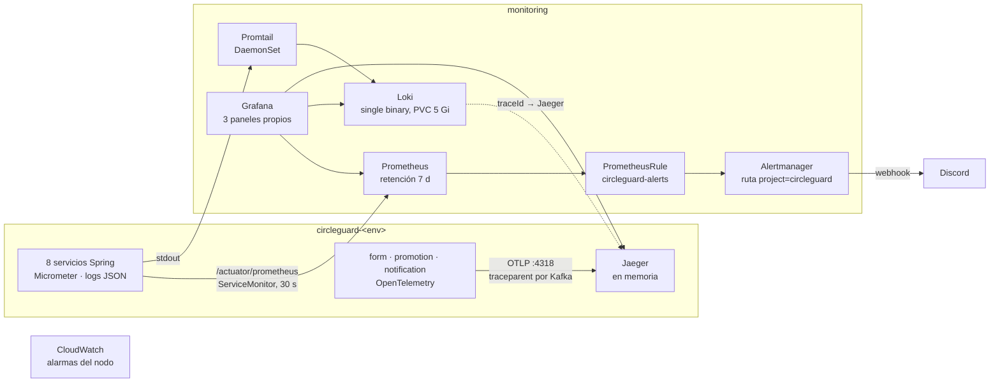

# Observabilidad

Las tres señales (métricas, logs y trazas) y las alertas, tal como corren en cada clúster. La guía
de instalación, verificación y prueba de cada pieza es
[`../operaciones/observability.md`](../operaciones/observability.md); qué hacer cuando salta una
alerta está en el [manual de operaciones](../operaciones/manual.md#3-alerta-disparada).

## Métricas

- Cada servicio Spring publica `/actuator/prometheus` con métricas de JVM, HTTP (con buckets de
  25 ms a 5 s para el p95) y contadores de negocio, todas con la etiqueta `application`.
- El ServiceMonitor `circleguard-services`, del chart, las lee cada 30 s y agrega `environment`.
- kube-prometheus-stack agrega node-exporter, kube-state-metrics y los objetivos del clúster.
  `kubeEtcd`, `kubeControllerManager`, `kubeScheduler` y `kubeProxy` están apagados porque k3s no
  los expone por separado.
- Prometheus guarda 7 días.

## Logs

Los servicios escriben una línea JSON por evento con `timestamp`, `level`, `service` y, si hay
traza, `traceId` y `spanId` ([`../patrones/logs.md`](../patrones/logs.md)). Promtail lee los logs
de los pods, extrae `level` y `service` como etiquetas y los envía a Loki. Loki corre en modo
single binary, con almacenamiento en filesystem sobre un PVC de 5 Gi. El datasource
`grafana-loki-jaeger` convierte el `traceId` de cada línea en un enlace a Jaeger.

CloudWatch no recibe logs de la aplicación: los log groups que crea Terraform están vacíos
([`infraestructura.md`](infraestructura.md#recursos-sin-consumidor)).

## Trazas

`form`, `promotion` y `notification` exportan trazas por OTLP a `http://jaeger:4318/v1/traces`. El
header `traceparent` viaja en los mensajes de Kafka, así que una encuesta se ve como una sola traza
desde `form` hasta `notification` ([`../patrones/trazas.md`](../patrones/trazas.md)). Jaeger
guarda hasta 2000 trazas en memoria: se pierden si el pod se reinicia.

## Paneles

| Panel | ConfigMap | Contenido |
|:---|:---|:---|
| CircleGuard · Servicios | `circleguard-dashboard-services` | Targets arriba, tráfico, errores 5xx, latencia p95 por endpoint, CPU, memoria y reinicios de pods, JVM, conexiones a PostgreSQL y lag de Kafka |
| CircleGuard · Negocio | `circleguard-dashboard-business` | Promociones y su origen, contactos por caso, cuestionarios, check-ins y tiempo de contención (p95 y porcentaje bajo 1 s) |
| CircleGuard redisHealth circuit | `circleguard-redis-health` (chart) | Estado y tasa de fallo del circuito del gateway |

Los JSON están en `observability/grafana/dashboards/` y en `deploy/k8s/circleguard/files/`. El
sidecar de Grafana los carga desde cualquier namespace con la etiqueta `grafana_dashboard`.

## Alertas

| Alerta | Condición | Espera | Severidad |
|:---|:---|:---|:---|
| `ServiceDown` | `up == 0` para un pod de `circleguard-*` | 1 min | `critical` |
| `HighErrorRate` | Más del 5 % de 5xx en 5 min, con tráfico mínimo | 2 min | `critical` |
| `HighLatencyP95` | p95 HTTP por encima de 1 s en 5 min, con tráfico mínimo | 5 min | `warning` |
| `CircuitBreakerOpen` | Circuito `redisHealth` del gateway abierto o semiabierto | 1 min | `critical` |

Alertmanager envía a Discord solo las alertas con `project=circleguard`, agrupadas por alerta,
namespace y servicio. Repite cada 4 horas y avisa al resolverse. Mientras un servicio tiene una
alerta `critical`, sus `warning` no se envían. La URL del webhook vive en el Secret
`alertmanager-discord`, fuera de Git. Las alertas propias del stack (nodo, kubelet, etc.) se ven en
`/alertmanager`, pero no se envían.

Las cuatro alertas se provocaron a propósito en dev y stage; la evidencia está en
[`../operaciones/evidencias/hu-41/`](../operaciones/evidencias/hu-41/README.md).

Fuera del clúster, CloudWatch tiene dos alarmas por nodo (CPU por encima de 80 % y status check
fallido) sobre un tema SNS sin suscriptores.

## Acceso

| Herramienta | Ruta | Acceso |
|:---|:---|:---|
| Grafana | `http://<ip-del-nodo>/grafana` | Login propio de Grafana |
| Prometheus | `http://<ip-del-nodo>/prometheus` | Basic Auth de Traefik (`monitoring-basic-auth`) |
| Alertmanager | `http://<ip-del-nodo>/alertmanager` | Basic Auth de Traefik |
| Jaeger | `kubectl -n circleguard-<env> port-forward svc/jaeger 16686:16686` | No se publica |
