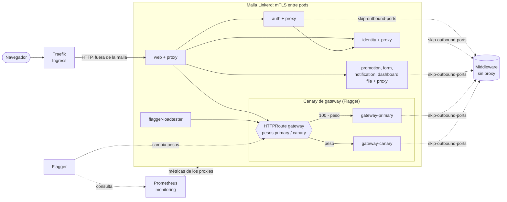

# Service mesh: Linkerd con mTLS y canary con Flagger

La malla cifra con mTLS las llamadas entre los servicios de la aplicación y permite liberar
`gateway` de forma progresiva. Cada ambiente lo activa en su `values-<env>.yaml`:

| Ambiente | Malla y mTLS (`mesh.enabled`) | Canary de `gateway` (`canary.enabled`) | Panel de Linkerd |
|:---|:---|:---|:---|
| `dev` | Sí | Sí | Sí |
| `stage` | Sí | Sí | Sí |
| `prod` | Sí | No, por memoria ([Memoria](#memoria)) | No |

## Decisión

| Criterio | Istio | Linkerd |
|:---|:---|:---|
| Soporte de k3s 1.30 | No: Istio 1.30 pide Kubernetes 1.32 a 1.36 | Sí: la línea 2.19 cubre 1.29 a 1.35 |
| Proxy por pod | Envoy, unos 290 MiB de límite por defecto | linkerd2-proxy (Rust), unos 10-20 MiB |
| mTLS | Configurable por política | Activo por defecto entre pods de la malla |
| Canary | VirtualService propio | HTTPRoute de Gateway API, que Flagger maneja |

Los nodos tienen 8 GB y, con la aplicación y el monitoreo, a `prod` le quedan unos 1,1 GB libres.
Linkerd 2.20 y las versiones *edge* posteriores piden Kubernetes 1.31, así que la versión fijada
es **edge-25.11.3** (chart `2025.11.3`, línea 2.19). Las versiones estables de Linkerd solo las
publica Buoyant; las *edge* son las del proyecto de código abierto.

| Componente | Versión | Dónde se fija |
|:---|:---|:---|
| Linkerd (`linkerd-crds`, `linkerd-control-plane`, `linkerd-viz`) | edge-25.11.3 | `deploy/k8s/scripts/install-mesh.sh` |
| Gateway API (canal estándar) | v1.2.1 | Mismo script; Linkerd 2.19 acepta 1.1.1 a 1.2.1 |
| Flagger | 1.45.0 | `deploy/k8s/scripts/install-mesh.sh` |
| Flagger load tester | 0.39.0 | Mismo script |

## Qué entra en la malla

Solo los 8 servicios Spring y el cliente web, es decir, todo lo que está en `services` de
`values.yaml`. El middleware (PostgreSQL, Neo4j, Kafka, Zookeeper, Redis, OpenLDAP y Jaeger) se
queda fuera. Meter esos pods en la malla añade proxies sin ganar mTLS de extremo a extremo, porque
sus clientes ya hablan sus propios protocolos. Los pods de la malla llegan a ellos sin pasar por
el proxy, por los puertos de `mesh.skipOutboundPorts`.



## mTLS e identidad

- **Cadena de certificados.** cert-manager emite el *trust anchor* de la malla (10 años) y, desde
  él, el certificado del emisor de identidad (48 horas, renovado solo). Linkerd firma con ese
  emisor un certificado de 24 horas para cada proxy. Los recursos están en
  `deploy/k8s/mesh/linkerd-identity.yaml`, y ninguna clave privada sale del clúster ni entra
  al repositorio.
- **Identidad por servicio.** Con la malla activa, cada servicio tiene su propia ServiceAccount
  (`auth`, `identity`, ...), sin token montado. La identidad TLS de un pod de `auth` en dev es
  `auth.circleguard-dev.serviceaccount.identity.linkerd.cluster.local`. Antes todos usaban
  `default`.
- **Política de entrada.** Se usa la de Linkerd por defecto, `all-unauthenticated`. Entre pods
  de la malla la conexión siempre va con mTLS. Traefik, el kubelet (sondas) y Prometheus no
  están en la malla y siguen entrando en texto plano.
- **Rotación del trust anchor.** Es manual. Renovarlo sin distribuir antes el nuevo corta todas las
  conexiones de la malla, así que el certificado no se renueva solo
  (`rotationPolicy: Never`, 10 años).

## Canary de `gateway`

Flagger toma el Deployment `gateway` del chart como plantilla.

1. Crea `gateway-primary`, que atiende todo el tráfico, y deja `gateway` en 0 réplicas.
2. Crea los Services `gateway` (apunta al primario), `gateway-primary` y `gateway-canary`, y un
   HTTPRoute cuyo padre es el Service `gateway`.
3. Con el canary activo, el chart deja de generar el Service `gateway` para no competir con
   Flagger. La ConfigMap del cliente web sigue apuntando a `gateway.<ns>.svc.cluster.local`.
4. Cada despliegue que cambia `gateway` (imagen, ConfigMap o anotaciones) arranca un análisis:

| Paso | Qué pasa |
|:---|:---|
| Aceptación | El load tester pide `/actuator/health/readiness` a `gateway-canary`. Si falla, no se mueve tráfico |
| Avance | Cada minuto se pasa un 20 % más del tráfico a `gateway-canary`, hasta el 60 % |
| Carga | Durante el análisis, el load tester envía 10 peticiones por segundo a `gateway` (`hey`), repartidas por el HTTPRoute |
| Métricas | Las de los proxies en Prometheus: éxito ≥ 99 % (respuestas no 5xx) y p99 ≤ 1000 ms |
| Promoción | Al 60 %, la nueva versión se copia a `gateway-primary` y el tráfico vuelve al primario |
| Reversión | Tras 3 comprobaciones fallidas, todo el tráfico vuelve a `gateway-primary` y el canary queda en 0 |

Los pesos del HTTPRoute solo los aplican los clientes que están en la malla (`web` y el load
tester). Como `gateway` solo recibe tráfico desde `web`, el reparto se aplica a todas las
peticiones reales.

En el pipeline, `deployK8s` ejecuta `wait-canary.sh` después de `helm upgrade`. Si Flagger
revierte el análisis, la etapa falla y el registro de HU-51 lo anota como fallido. Helm ya terminó,
así que queda la revisión nueva, pero el tráfico lo atiende el primario anterior. El siguiente
despliegue, o el job de rollback, arranca otro análisis. Flagger publica `flagger_canary_status`,
y la alerta `CanaryFailed` (`observability/alerts`) avisa en Discord cuando un análisis falla.

Las métricas de `gateway-primary` y `gateway-canary` siguen apareciendo como `service="gateway"` y
`job="gateway"` en Prometheus. El ServiceMonitor del chart toma la etiqueta
`app.kubernetes.io/name`, así que los paneles y las alertas existentes no cambian.

## Instalación por ambiente

El pipeline no instala la malla. Se instala una vez por clúster, como el monitoreo, con
`deploy/k8s/scripts/install-mesh.sh`, que es idempotente: volver a correrlo actualiza o aplica
cambios de `deploy/k8s/mesh/`. Las opciones dicen qué se instala:

| Ambiente | Comando | Instala |
|:---|:---|:---|
| `dev` | `install-mesh.sh --canary --viz linkerd.52.204.64.188.sslip.io` | Linkerd, Flagger, load tester y panel |
| `stage` | `install-mesh.sh --canary --viz linkerd.3.221.162.144.sslip.io` | Lo mismo |
| `prod` | `install-mesh.sh` | Solo Linkerd |

Siempre instala Gateway API (v1.2.1), cert-manager, la identidad de la malla y el control plane.
`--viz` necesita el Secret de BasicAuth de `/prometheus` (`infra/bootstrap/load-monitoring-auth.sh`).

Desde Windows se corre en el nodo por SSH. El bloque de PowerShell no debe llevar comillas dobles,
porque PowerShell las quita al pasarle el texto a `ssh`:

```powershell
$key = "<llave .pem>"; $node = "52.204.64.188"   # dev; stage 3.221.162.144; prod 34.227.254.255
ssh -i $key ubuntu@$node "rm -rf ~/cg && mkdir -p ~/cg/deploy"
scp -i $key -r deploy/k8s ubuntu@${node}:~/cg/deploy/
ssh -i $key ubuntu@$node @'
cd ~/cg
find deploy -type f \( -name '*.sh' -o -name '*.yaml' \) -exec sed -i 's/\r$//' {} +
sudo env KUBECONFIG=/etc/rancher/k3s/k3s.yaml PATH=$PATH bash deploy/k8s/scripts/install-mesh.sh --canary --viz linkerd.52.204.64.188.sslip.io
rm -rf ~/cg
'@
```

El `sed` quita los finales de línea de Windows. Después de instalar, el siguiente despliegue del
chart pone el proxy en los pods. Los que ya corrían entran a la malla al reiniciarse:
`kubectl -n circleguard-<env> rollout restart deployment`.

Para revisar el chart sin clúster, `helm template` necesita las API de Flagger y Gateway API, o
el Canary no se genera:

```bash
helm template circleguard deploy/k8s/circleguard -n circleguard-dev \
  -f deploy/k8s/circleguard/values-dev.yaml --set image.registry=r:5000 --set image.tag=0.0.0 \
  --api-versions flagger.app/v1beta1/Canary --api-versions gateway.networking.k8s.io/v1/HTTPRoute \
  --api-versions monitoring.coreos.com/v1/ServiceMonitor
```

## Uso

### Dónde mirar

| Qué | Dónde | Acceso |
|:---|:---|:---|
| Panel de Linkerd | `https://linkerd.<ip-del-nodo>.sslip.io/` (dev y stage) | Usuario BasicAuth de `/prometheus` |
| Canary y malla | Grafana (`/grafana`), panel **CircleGuard · Canary y malla** | Usuario de Grafana |
| Estado del canary | `kubectl -n circleguard-<env> get canary gateway` | kubeconfig del ambiente |
| Alerta de canary fallido | Discord, `CanaryFailed` | — |

- **Panel de Linkerd (linkerd-viz):** muestra el tráfico entre Deployments, la tasa de éxito, la
  latencia, las rutas y `tap` en vivo. Un candado en una conexión indica mTLS.
  - Usa un nombre propio, `linkerd.<ip>.sslip.io`, porque solo funciona desde la raíz.
  - Rechaza cualquier `Host` que no conoce (protección contra DNS rebinding);
    `dashboard.enforcedHostRegexp` agrega ese nombre a los aceptados.
  - El certificado es de la CA del laboratorio, con la misma advertencia que `/grafana`.
- **Flagger no tiene interfaz propia.** El panel de Grafana lee sus métricas:
  - `flagger_canary_status`: estado del último análisis.
  - `flagger_canary_weight`: peso de primary y canary.
  - `flagger_canary_metric_analysis`: valor de cada comprobación.

  Junto a esas, el panel muestra, desde los proxies, la tasa de éxito, la latencia p99 y la parte
  del tráfico que entra con mTLS.

### Liberar una versión con canary

No hay pasos extra: el pipeline despliega como siempre. Lo que cambia es lo que pasa después.

1. Helm actualiza el Deployment `gateway`. Flagger detecta la revisión nueva en el siguiente minuto.
2. El load tester comprueba la readiness de `gateway-canary`. Después el tráfico sube 20 % por
   minuto hasta el 60 %, mientras se miden éxito ≥ 99 % y p99 ≤ 1 s.
3. Con todo bien, la versión pasa a `gateway-primary` (`Succeeded`). `deployK8s` espera ese
   resultado con `wait-canary.sh` antes del smoke test.
4. Con 3 comprobaciones fallidas, el tráfico vuelve al primario (`Failed`). La etapa falla, el
   registro de HU-51 la anota como fallida y llega `CanaryFailed` a Discord.

```bash
kubectl -n circleguard-<env> get canary gateway -w           # fases y peso
kubectl -n circleguard-<env> describe canary gateway | tail   # eventos de cada comprobación
kubectl -n circleguard-<env> get httproute gateway -o yaml    # pesos actuales
```

### Operaciones frecuentes

| Necesidad | Cómo |
|:---|:---|
| Provocar un análisis sin versión nueva | `kubectl -n circleguard-<env> patch deployment gateway --type merge -p '{"spec":{"template":{"metadata":{"annotations":{"circleguard.io/canary-test":"1"}}}}}'` (cambiar el valor cada vez) |
| Probar una reversión | `kubectl -n circleguard-<env> set env deployment/gateway SPRING_DATA_REDIS_HOST=redis-inexistente`. `/actuator/health` responde 503 y Flagger revierte. Se deshace con `... SPRING_DATA_REDIS_HOST-` |
| Promover sin análisis (urgencia) | `kubectl -n circleguard-<env> patch canary gateway --type merge -p '{"spec":{"skipAnalysis":true}}'`. El siguiente despliegue del chart lo vuelve a `false` |
| Volver a la versión anterior | Job de rollback (`docs/operaciones/rollback.md`). Cambia el Deployment, así que también pasa por un análisis |
| Sacar un servicio de la malla | Anotación `linkerd.io/inject: disabled` en el pod, o `mesh.enabled: false` para todo el ambiente |
| Apagar el canary de un ambiente | `canary.enabled: false` en `values-<env>.yaml` y desplegar. El chart vuelve a crear el Service `gateway` |
| Ver la identidad de un proxy | `kubectl -n circleguard-<env> logs deploy/auth -c linkerd-proxy \| grep -i identity` |

### Problemas conocidos

| Síntoma | Causa y arreglo |
|:---|:---|
| Pods en `1/1` después de instalar | Arrancaron antes que Linkerd. `rollout restart deployment` |
| Pod detenido en `linkerd-init` | Reglas de iptables. Revisar `kubectl logs <pod> -c linkerd-init`; los nodos usan `nft` |
| Canary en `Progressing` sin avanzar, con "no values found" | No hay tráfico medido. Revisar que el load tester esté en `2/2` y que existan los PodMonitors (`kubectl get podmonitor -A`) |
| El panel de Linkerd responde "It appears that you are trying to reach this service with a host of..." | El nombre no coincide con `enforcedHostRegexp` de `linkerd-viz-values.yaml` |
| `https://linkerd.<ip>.sslip.io` abre la aplicación | No existe el Ingress del panel. Correr `install-mesh.sh --viz <host>` |
| `install-mesh.sh` falla con `permission denied` en `k3s.yaml` | Se corrió sin `sudo env KUBECONFIG=...` |

## Verificación

| Qué | Cómo |
|:---|:---|
| Control plane sano | `kubectl -n linkerd get pods` y, con la CLI de Linkerd, `linkerd check` |
| Pods con proxy | `kubectl -n circleguard-<env> get pods`: los servicios muestran `2/2`, el middleware `1/1` |
| Tráfico con mTLS | Panel de Linkerd (candado) o, en Prometheus, `sum by (deployment, tls) (rate(response_total{namespace="circleguard-dev", direction="inbound"}[5m]))`. Lo que llega de `web` sale con `tls="true"` |
| Canary | Promoción y reversión como en [Operaciones frecuentes](#operaciones-frecuentes) |

## Memoria

| Pieza | Estimado |
|:---|:---|
| Control plane (destination, identity, proxy-injector y sus proxies) | 150-250 MiB |
| 9 proxies de la aplicación (11 en `prod` por el HPA) | 90-220 MiB |
| Flagger y load tester (con proxy) | 50-80 MiB |
| linkerd-viz sin Prometheus propio (4 pods con proxy) | 150-200 MiB |
| Pod extra de `gateway-canary` durante un análisis | 300-450 MiB (JVM) |

Medido en `dev`: cert-manager, Linkerd, Flagger y el load tester bajaron la memoria disponible de
1737 a 1322 MiB, y linkerd-viz la dejó en 1238 MiB.

- **`stage`:** con 1556 MiB libres antes de la malla, le queda espacio para todo, incluido el pod
  extra de cada análisis.
- **`prod`:** con 1148 MiB libres y `gateway` y `form` en 2 réplicas, solo lleva la malla. Con
  canary y linkerd-viz quedaría con unos 100 MiB durante un análisis, y eso arriesga OOM. Para
  activar el canary en `prod` hay que agrandar el nodo (tipo de instancia en Terraform) y poner
  `canary.enabled: true` en `values-prod.yaml`.

## Límites conocidos

- El middleware no tiene mTLS. Sus conexiones siguen como antes, dentro del nodo.
- No hay `AuthorizationPolicy`: cualquier pod de la malla puede llamar a cualquier servicio. El
  siguiente paso natural es restringir `gateway`, `auth` e `identity` por ServiceAccount.
- Mientras se activa el canary por primera vez, Helm borra el Service `gateway` y Flagger lo crea
  de nuevo al inicializar. `gateway` deja de responder hasta que el primario está listo, unos
  minutos.
- El rollback de Helm también pasa por el análisis, porque cambia el Deployment `gateway`.
