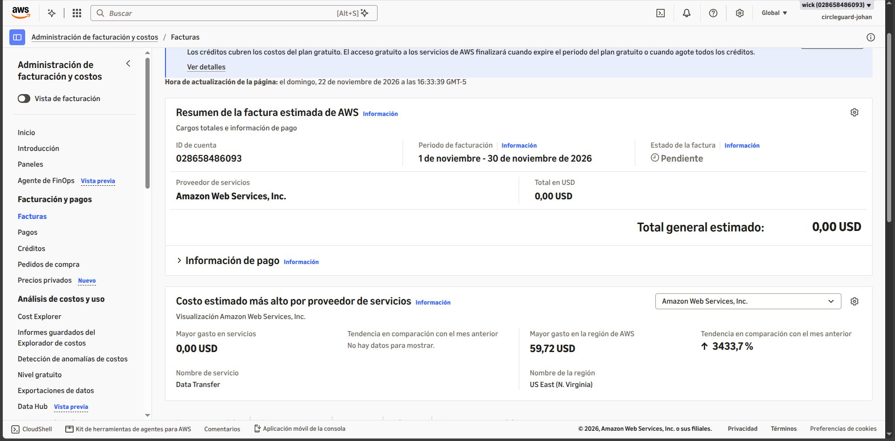
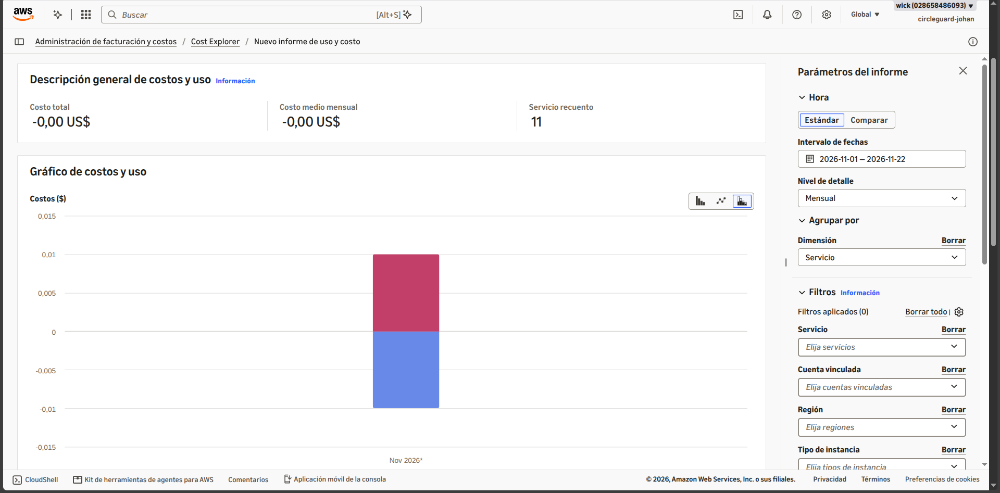
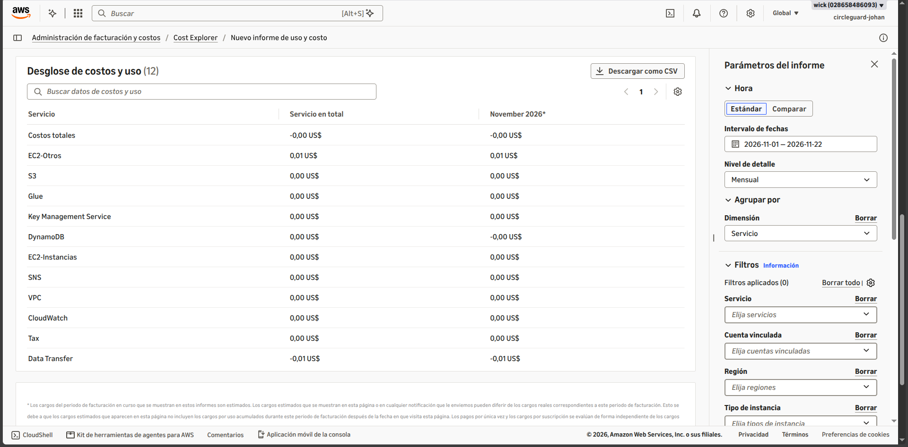
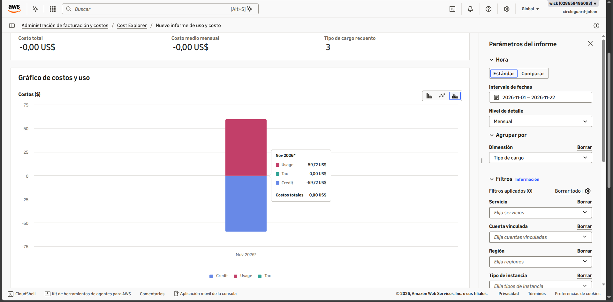
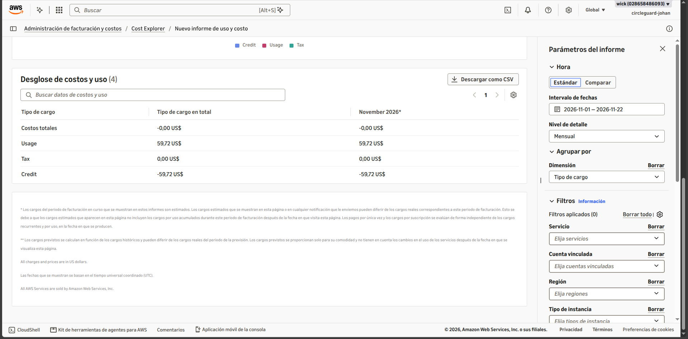

# Costo real del periodo

Datos consultados en AWS Cost Explorer el **22 de noviembre de 2026** para el periodo
`2026-11-01` a `2026-11-22` en la cuenta `028658486093`, región `us-east-1`. El periodo
definitivo corresponde a la factura al cierre del mes; esta tabla se actualiza con esa
factura.

## Resumen

| Concepto | Valor |
|:---|:---|
| Periodo | 1–22 de noviembre de 2026 |
| Uso (UnblendedCost) | **$59.723136** |
| Créditos | **−$59.723137** |
| Impuestos | $0 |
| **Neto** | **≈ $0** |

La cuenta tiene créditos que cubren el uso del periodo. El pago neto es prácticamente cero,
pero el consumo real (precio de uso) fue de $59.72.

## Evidencia de facturación

La factura estimada de noviembre de 2026 muestra un total de **$0.00**; el mayor gasto
regional es **$59.72** en `Data Transfer` y los créditos cubren el uso.



Cost Explorer por servicio: el neto por servicio es cercano a cero y la mayor parte del uso
está cubierta por créditos.





Cost Explorer por tipo de cargo: **Usage $59.72**, **Credit −$59.72**, **Tax $0.00**, total
**$0.00**.





## Por qué la factura no coincide con la estimación

La estimación de [`estimacion.md`](estimacion.md) es un mes completo de precio de lista
on-demand (≈ $390), mientras que el periodo real tiene:

1. **Periodo parcial:** los datos cubren 22 días, no el mes completo.
2. **Nodos k3s creados el 15 de noviembre:** solo facturan desde esa fecha.
3. **Hosts legacy detenidos:** `circleguard-dev`, `stage` y `prod` no pagan cómputo; solo sus
   volúmenes EBS.
4. **Créditos de la cuenta:** los $59.72 de uso están cubiertos por créditos.
5. **Recursos vacíos:** ECR no tiene imágenes y los buckets de archivos están vacíos, así que
   el costo variable es casi nulo.
6. **Descuentos/free tier:** el precio efectivo puede ser menor que el precio de lista.
7. **Transferencia y logs:** la estimación usa supuestos; la factura refleja el uso real.

## Cómo reproducir los datos

```bash
aws ce get-cost-and-usage \
  --time-period Start=2026-11-01,End=2026-11-23 \
  --granularity MONTHLY \
  --metrics UnblendedCost \
  --group-by Type=DIMENSION,Key=RECORD_TYPE
```

En la consola: **Billing and Cost Management → Cost Explorer → Cost and usage**, filtrar por
el periodo y agrupar por *Service* o *Record type*. Para la factura: **Bills → November 2026**.

## Costos que permanecen

La destrucción de los tres ambientes **no se ejecutó**; `dev`, `stage` y `prod` siguen
activos. Permanecen también estos cargos:

- `circleguard-ci` y `circleguard-tools` encendidos.
- Volúmenes EBS de los hosts legacy detenidos y de CI/tools.
- IPs públicas de CI/tools y de los ambientes.
- Bucket S3 del state y tabla DynamoDB del lock (`prevent_destroy`).

El estado final y la decisión de no destruir están en
[`evidencia-destroy.md`](evidencia-destroy.md).

## Cierre del periodo

La versión final del informe usa el periodo definitivo de la factura y conserva:

1. El periodo y la tabla de uso/créditos/neto.
2. Las capturas de facturación en `docs/costos/capturas/`.
3. La explicación de la diferencia entre el precio de lista y el costo real.
4. La comparación vigente con el estado final de los ambientes.
