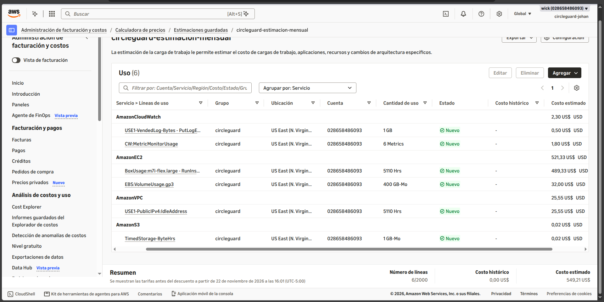

# Estimación de costos

Estimación de precio de lista para un mes completo en `us-east-1`, modalidad **on-demand**,
sin impuestos ni créditos. Es una referencia para comparar con la factura real; la fuente
definitiva es AWS Pricing Calculator.

La captura de la estimación de AWS Pricing Calculator se incluye a continuación.

## Supuestos

- Región `us-east-1` (Norte de Virginia).
- 730 horas al mes (24/7).
- Linux, instancias compartidas, sin Savings Plans ni Reserved Instances.
- Precios de lista tomados de AWS Pricing Calculator (captura al inicio del documento).
- Los 3 hosts legacy `circleguard-dev`, `circleguard-stage` y `circleguard-prod` están
  **detenidos**: no pagan cómputo, pero sí sus volúmenes EBS.
- Los buckets de archivos y los repositorios ECR están vacíos, así que su costo variable
  es cercano a cero.
- La transferencia de salida se estima dentro de los primeros 100 GB gratuitos; si el uso
  real supera ese umbral, se agrega a $0.09/GB.

## Inventario

| Recurso | Cantidad | Fuente |
|:---|:---|:---|
| Instancias `m7i-flex.large` encendidas | 7 | `aws ec2 describe-instances` |
| Hosts legacy `m7i-flex.large` detenidos | 3 | `aws ec2 describe-instances` |
| Volúmenes EBS gp3 | 11 (400 GB: 380 GB de CircleGuard + 20 GB de `citypulse`) | `aws ec2 describe-volumes` |
| Direcciones IPv4 públicas | 7 (4 EIP + `tools` + 2 workers) | `aws ec2 describe-addresses` |
| Repositorios ECR | 24 (0 imágenes) | `aws ecr describe-repositories` |
| Buckets de archivos | 3 (vacíos) | `aws s3api list-object-versions` |
| Bucket del state | 1 (4 objetos, ≈283 KB) | `aws s3api list-objects-v2` |
| Log groups `/circleguard/*` | 24 (0 bytes almacenados) | `aws logs describe-log-groups` |
| Alarmas CloudWatch | 6 | `aws cloudwatch describe-alarms` |
| Topics SNS | 3 | `aws sns list-topics` |
| Tabla DynamoDB del lock | 1 (4 ítems, 456 bytes) | `aws dynamodb describe-table` |

## Cálculo mensual

| Concepto | Cantidad | Precio unitario aproximado | Mensual |
|:---|:---|:---|:---|
| EC2 `m7i-flex.large` Linux | 7 × 730 h (5110 h) | ≈$0.0958/h | $489.33 |
| EBS gp3 | 400 GB | $0.08/GB-mes | $32.00 |
| IPv4 pública | 7 × 730 h (5110 h) | $0.005/h | $25.55 |
| CloudWatch (1 GB de logs + 6 métricas) | 1 GB + 6 | — | $2.30 |
| S3 (state y archivos) | 1 GB | $0.023/GB-mes | $0.02 |
| ECR | 0 imágenes | — | $0.00 |
| SNS | notificaciones mínimas | — | $0.00 |
| DynamoDB on-demand | 456 bytes | — | $0.00 |
| Transferencia de salida | ≤100 GB | $0.00 (primeros 100 GB) | $0.00 |
| **Total estimado** | | | **≈ $549.21 USD/mes** |

Total del Pricing Calculator: **$549.21 USD/mes**.

Si se excluye `citypulse`, el EBS de CircleGuard es 380 GB y el total aproximado baja a
**$547.60/mes**.

Si los 3 hosts legacy se encienden, se suman **≈ $210/mes** de cómputo
(3 × 730 h × $0.0958); el EBS ya está incluido. Si se encienden solo algunos, el costo se
prorratea.

## Metodología de la estimación

La estimación de precio de lista se construyó en AWS Pricing Calculator
(<https://calculator.aws/>) para `us-east-1` con estos componentes:

- 7 × Amazon EC2 `m7i-flex.large`, Linux, 730 h/mes (CI, 2 workers, tools, 3 k3s).
- 3 × Amazon EC2 `m7i-flex.large` detenidas (solo EBS; el EBS agregado ya está incluido).
- 400 GB de EBS gp3 (380 GB de CircleGuard + 20 GB de `citypulse`).
- 7 direcciones IPv4 públicas.
- 24 repositorios ECR y 0 GB de imágenes.
- 1 GB de S3 Standard.
- 24 log groups de CloudWatch, 1 GB de ingesta estimada y 6 alarmas.
- 3 topics SNS, DynamoDB on-demand y la transferencia estimada.

La captura de la estimación se incluye al inicio de este documento y corresponde al
inventario con los dos build workers de Jenkins. Las cantidades de esta tabla se actualizan
cuando cambia el inventario de la cuenta.

## Comparación con el costo real

El periodo real consultado (1–22 de noviembre de 2026) tiene un uso de **$59.72**, cubierto
por **−$59.72** de créditos, para un neto de **≈ $0**. No es directamente comparable con los
≈$549.21 del mes completo porque:

- El periodo es parcial y los nodos k3s se crearon el 15 de noviembre.
- Los dos build workers de Jenkins se agregaron el 22 de noviembre, cerca del final del
  periodo consultado.
- Los 3 hosts legacy están detenidos.
- La cuenta tiene créditos y posibles descuentos/free tier.
- Los buckets de archivos y ECR están vacíos.
- La calculadora usa precio de lista 24/7 sin impuestos.

Ver [`costos-reales.md`](costos-reales.md) para el detalle de la facturación y su evidencia
gráfica.
