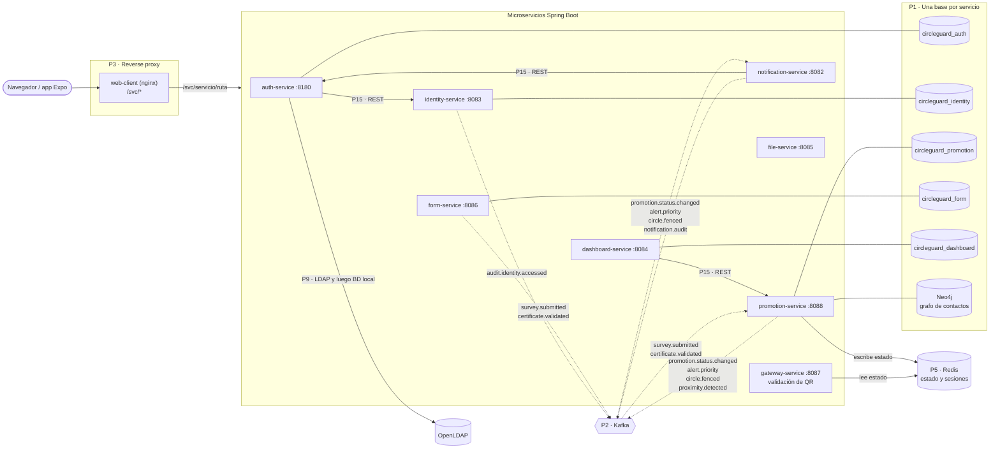
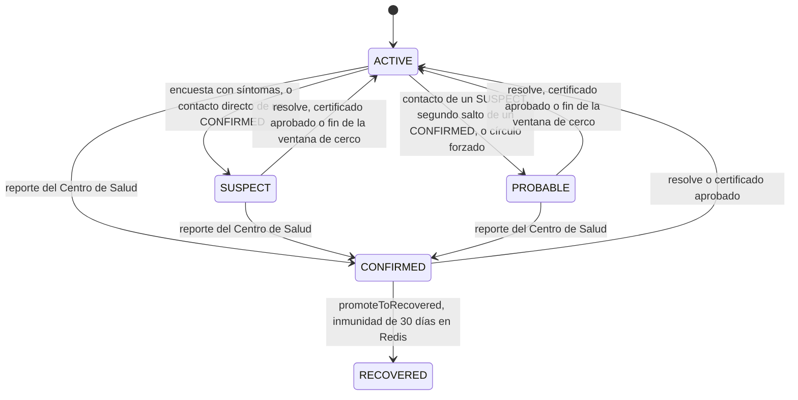

# Catálogo de patrones existentes en CircleGuard

> **Historia de usuario.** Como arquitecto del equipo, quiero identificar y documentar los patrones ya presentes en CircleGuard con evidencia en el código, para justificar el diseño y la elección de nuevos patrones.

**Alcance.** Revisión estática de la rama `docs/design-patterns` (2026-11-20): los 8 servicios de `services/`, el reverse proxy de `mobile/nginx.conf` y el despliegue de `deploy/compose/`. No se ejecutó la aplicación; lo que se afirma sale de lo que el código declara y conecta.

**Cómo leer cada entrada.** *Propósito* dice qué problema resuelve el patrón en CircleGuard. *Evidencia* enlaza a archivo y líneas (`Archivo:inicio-fin`). *Verificación* indica qué comprobar en esa evidencia. *Matiz* recoge lo que el código no cumple del todo. La sección 7 trae comandos `git grep` para repetir la comprobación.

## 1. Resumen

| # | Patrón | Servicios | Evidencia principal |
|---|--------|-----------|---------------------|
| P1 | Database-per-service (persistencia políglota) | auth, identity, promotion, form, dashboard | [`init-db.sql:2-6`](../../deploy/compose/postgres/init-db.sql#L2-L6) |
| P2 | Orientado a eventos: publicar/suscribir sobre Kafka | form, promotion, notification, identity | [`SurveyListener.java:16`](../../services/circleguard-promotion-service/src/main/java/com/circleguard/promotion/listener/SurveyListener.java#L16) |
| P3 | Reverse proxy como punto de entrada (API Gateway ligero) | web-client (nginx) | [`nginx.conf:48-88`](../../mobile/nginx.conf#L48-L88) |
| P4 | Cache-aside (Spring Cache + Caffeine) | promotion | [`CacheConfig.java:13-27`](../../services/circleguard-promotion-service/src/main/java/com/circleguard/promotion/config/CacheConfig.java#L13-L27) |
| P5 | Proyección de estado en Redis (write-through) y estado efímero con TTL | promotion, gateway | [`HealthStatusService.java:96-111`](../../services/circleguard-promotion-service/src/main/java/com/circleguard/promotion/service/HealthStatusService.java#L96-L111) |
| P6 | Máquina de estados de salud (implícita) | promotion | [`HealthStatusService.java:40-138`](../../services/circleguard-promotion-service/src/main/java/com/circleguard/promotion/service/HealthStatusService.java#L40-L138) |
| P7 | Despacho multicanal asíncrono (interfaz por canal + fan-out) | notification | [`NotificationDispatcher.java:28-32`](../../services/circleguard-notification-service/src/main/java/com/circleguard/notification/service/NotificationDispatcher.java#L28-L32) |
| P8 | Retry con backoff y recuperación | notification | [`EmailServiceImpl.java:22-26`](../../services/circleguard-notification-service/src/main/java/com/circleguard/notification/service/EmailServiceImpl.java#L22-L26) |
| P9 | Cadena de autenticación con fallback | auth | [`DualChainAuthenticationProvider.java:18-27`](../../services/circleguard-auth-service/src/main/java/com/circleguard/auth/security/DualChainAuthenticationProvider.java#L18-L27) |
| P10 | Filtro de interceptación JWT y RBAC declarativo | auth, promotion, identity | [`JwtAuthenticationFilter.java:22-23`](../../services/circleguard-auth-service/src/main/java/com/circleguard/auth/security/JwtAuthenticationFilter.java#L22-L23) |
| P11 | Token efímero firmado (QR) | auth, gateway | [`QrTokenService.java:23-30`](../../services/circleguard-auth-service/src/main/java/com/circleguard/auth/service/QrTokenService.java#L23-L30) |
| P12 | Pseudonimización con vault de identidad | identity, auth | [`IdentityVaultService.java:27-42`](../../services/circleguard-identity-service/src/main/java/com/circleguard/identity/service/IdentityVaultService.java#L27-L42) |
| P13 | Privacidad por diseño: k-anonimato y retención | dashboard, promotion | [`KAnonymityFilter.java:12-65`](../../services/circleguard-dashboard-service/src/main/java/com/circleguard/dashboard/service/KAnonymityFilter.java#L12-L65) |
| P14 | Repository y gestor de transacciones por almacén | promotion | [`DataLayerConfig.java:8-16`](../../services/circleguard-promotion-service/src/main/java/com/circleguard/promotion/config/DataLayerConfig.java#L8-L16) |
| P15 | Cliente REST síncrono y composición de API | auth, dashboard, notification | [`PromotionClient.java:14-30`](../../services/circleguard-dashboard-service/src/main/java/com/circleguard/dashboard/client/PromotionClient.java#L14-L30) |
| P16 | Migraciones versionadas (Flyway) | auth, identity, promotion, form, dashboard | [`promotion/build.gradle.kts:37`](../../services/circleguard-promotion-service/build.gradle.kts#L37) |
| P17 | Configuración externalizada y health check | todos | [`stack.yml:144-148`](../../deploy/compose/stack.yml#L144-L148) |

## 2. Diagramas

### 2.1 Vista general

Las flechas continuas son llamadas síncronas; las punteadas, eventos de Kafka. Los rótulos P# remiten a las entradas de la sección 3.



### 2.2 Máquina de estados de salud (P6)

Simplificado: omite el sentido de cada consulta Cypher y los casos de `adminOverride`.



## 3. Catálogo

### P1. Database-per-service (persistencia políglota)

**Propósito.** Cada servicio es dueño de sus datos y los demás los piden por API o por evento, no por SQL. Así se evita el acoplamiento por esquema, y promotion puede usar un grafo (Neo4j) para los contactos mientras el resto usa PostgreSQL.

**Evidencia**
- El script de arranque de PostgreSQL crea una base por servicio: auth, identity, promotion, dashboard y form ([`init-db.sql:2-6`](../../deploy/compose/postgres/init-db.sql#L2-L6)).
- Cada servicio apunta a la suya: [`auth/application.yml:5`](../../services/circleguard-auth-service/src/main/resources/application.yml#L5), [`identity/application.yml:8`](../../services/circleguard-identity-service/src/main/resources/application.yml#L8), [`promotion/application.yml:5`](../../services/circleguard-promotion-service/src/main/resources/application.yml#L5), [`form/application.yml:5`](../../services/circleguard-form-service/src/main/resources/application.yml#L5), [`dashboard/application.yml:5`](../../services/circleguard-dashboard-service/src/main/resources/application.yml#L5).
- promotion guarda además el grafo de contactos en Neo4j ([`promotion/application.yml:15-19`](../../services/circleguard-promotion-service/src/main/resources/application.yml#L15-L19)); los repositorios están en P14.
- notification-service y gateway-service no declaran `datasource`; gateway solo usa Redis (P5).
- No hay acceso cruzado: dashboard consulta su propia base con `JdbcTemplate` ([`AnalyticsService.java:35-39`](../../services/circleguard-dashboard-service/src/main/java/com/circleguard/dashboard/service/AnalyticsService.java#L35-L39)) y pide los datos de salud a promotion por REST ([`AnalyticsService.java:19-21`](../../services/circleguard-dashboard-service/src/main/java/com/circleguard/dashboard/service/AnalyticsService.java#L19-L21)).

**Verificación.** `git grep -n "jdbc:postgresql" -- "services/*/src/main/resources/application.yml"` muestra una base distinta por servicio.

**Matiz.** El aislamiento es lógico: hay una sola instancia de PostgreSQL y una credencial compartida por todos los servicios ([`stack.yml:30-40`](../../deploy/compose/stack.yml#L30-L40), [`stack.yml:34-36`](../../deploy/compose/stack.yml#L34-L36)).

### P2. Orientado a eventos: publicar/suscribir sobre Kafka

**Propósito.** Que el motor de estados no conozca a quienes reaccionan a un cambio. Es coreografía: no hay orquestador. Por ejemplo, una encuesta con síntomas publica `survey.submitted`, promotion sube al usuario a SUSPECT, publica `promotion.status.changed` y notification envía las alertas.

**Evidencia.** Tópicos, productor y consumidor:

| Tópico | Productor | Consumidor |
|--------|-----------|------------|
| `survey.submitted` | form: [`HealthSurveyService.java:52`](../../services/circleguard-form-service/src/main/java/com/circleguard/form/service/HealthSurveyService.java#L52) | promotion: [`SurveyListener.java:16`](../../services/circleguard-promotion-service/src/main/java/com/circleguard/promotion/listener/SurveyListener.java#L16) |
| `certificate.validated` | form: [`HealthSurveyService.java:77`](../../services/circleguard-form-service/src/main/java/com/circleguard/form/service/HealthSurveyService.java#L77) | promotion: [`SurveyListener.java:33`](../../services/circleguard-promotion-service/src/main/java/com/circleguard/promotion/listener/SurveyListener.java#L33) |
| `promotion.status.changed` | promotion: [`HealthStatusService.java:119`](../../services/circleguard-promotion-service/src/main/java/com/circleguard/promotion/service/HealthStatusService.java#L119), [`StatusLifecycleService.java:76`](../../services/circleguard-promotion-service/src/main/java/com/circleguard/promotion/service/StatusLifecycleService.java#L76) | notification: [`ExposureNotificationListener.java:22`](../../services/circleguard-notification-service/src/main/java/com/circleguard/notification/service/ExposureNotificationListener.java#L22) |
| `alert.priority` | promotion: [`HealthStatusService.java:135`](../../services/circleguard-promotion-service/src/main/java/com/circleguard/promotion/service/HealthStatusService.java#L135) | notification: [`PriorityAlertListener.java:27`](../../services/circleguard-notification-service/src/main/java/com/circleguard/notification/service/PriorityAlertListener.java#L27) |
| `circle.fenced` | promotion: [`HealthStatusService.java:150`](../../services/circleguard-promotion-service/src/main/java/com/circleguard/promotion/service/HealthStatusService.java#L150) | notification: [`CircleFencedListener.java:20`](../../services/circleguard-notification-service/src/main/java/com/circleguard/notification/service/CircleFencedListener.java#L20) |
| `proximity.detected` | promotion: [`LocationResolutionService.java:57`](../../services/circleguard-promotion-service/src/main/java/com/circleguard/promotion/service/LocationResolutionService.java#L57) | ninguno en el repositorio |
| `audit.identity.accessed` | identity: [`IdentityVaultController.java:97`](../../services/circleguard-identity-service/src/main/java/com/circleguard/identity/controller/IdentityVaultController.java#L97) | ninguno en el repositorio |
| `notification.audit` | notification: [`AuditLogService.java:33`](../../services/circleguard-notification-service/src/main/java/com/circleguard/notification/service/AuditLogService.java#L33) | ninguno en el repositorio |

- Cada consumidor tiene su grupo propio: [`promotion/application.yml:20-28`](../../services/circleguard-promotion-service/src/main/resources/application.yml#L20-L28), [`notification/application.yml:4-10`](../../services/circleguard-notification-service/src/main/resources/application.yml#L4-L10); form serializa a JSON ([`form/application.yml:15-19`](../../services/circleguard-form-service/src/main/resources/application.yml#L15-L19)).
- identity publica un evento con sobre estructurado (`eventId`, `eventType`, `metadata.correlationId`, `version`): [`IdentityAccessEvent.java:8-10`](../../services/circleguard-identity-service/src/main/java/com/circleguard/identity/event/IdentityAccessEvent.java#L8-L10), [`IdentityVaultController.java:80-97`](../../services/circleguard-identity-service/src/main/java/com/circleguard/identity/controller/IdentityVaultController.java#L80-L97).

**Verificación.** `git grep -n "@KafkaListener" -- "services/*/src/main/*"` lista exactamente cinco suscripciones; `git grep -n "kafkaTemplate.send" -- "services/*/src/main/*"` lista los productores de la tabla.

**Matiz.** Solo identity usa un sobre tipado; el resto envía `Map`. Tres tópicos no tienen consumidor en este repositorio; puede que los lea un sistema externo, y conviene confirmarlo.

### P3. Reverse proxy como punto de entrada (API Gateway ligero)

**Propósito.** Que el navegador hable con un único origen (`/svc/<servicio>/...`) y nginx reenvíe cada ruta al servicio correcto, sin que el cliente conozca hosts ni puertos internos.

**Evidencia**
- Una ruta `location /svc/<servicio>/` por cada servicio, con `rewrite` y `proxy_pass` hacia una variable `*_UPSTREAM`: [`nginx.conf:48-88`](../../mobile/nginx.conf#L48-L88).
- La plantilla se resuelve al arrancar el contenedor, así la misma imagen sirve en dev, stage y prod: [`nginx.conf:1-11`](../../mobile/nginx.conf#L1-L11), [`stack.yml:249-262`](../../deploy/compose/stack.yml#L249-L262).
- Cabeceras de seguridad comunes en el borde: [`nginx.conf:22-24`](../../mobile/nginx.conf#L22-L24).

**Verificación.** `git grep -n "location /svc/" -- mobile/nginx.conf` devuelve ocho rutas.

**Aclaración.** `gateway-service` no es un API Gateway. Valida los QR de entrada al campus ([`GateController.java:9-19`](../../services/circleguard-gateway-service/src/main/java/com/circleguard/gateway/controller/GateController.java#L9-L19), [`QrValidationService.java:23-31`](../../services/circleguard-gateway-service/src/main/java/com/circleguard/gateway/service/QrValidationService.java#L23-L31)) y sus dependencias no incluyen Spring Cloud Gateway ([`gateway/build.gradle.kts:15-19`](../../services/circleguard-gateway-service/build.gradle.kts#L15-L19)). Donde se hable de «API Gateway» como patrón presente, se refiere a este nginx.

**Matiz.** El proxy enruta y agrega cabeceras; no autentica, no limita la tasa ni agrega respuestas. La autenticación ocurre en cada servicio (P10).

### P4. Cache-aside (Spring Cache + Caffeine)

**Propósito.** Evitar una consulta a PostgreSQL por la fila singleton de configuración en cada operación del motor de estados, e invalidarla cuando un administrador la cambia.

**Evidencia**
- Caffeine con máximo de 10 000 entradas y expiración a los 5 minutos de escribir: [`CacheConfig.java:13-27`](../../services/circleguard-promotion-service/src/main/java/com/circleguard/promotion/config/CacheConfig.java#L13-L27), [`CacheConfig.java:20-26`](../../services/circleguard-promotion-service/src/main/java/com/circleguard/promotion/config/CacheConfig.java#L20-L26).
- Lectura con `@Cacheable("systemSettings")`: [`SystemSettingsRepository.java:16-19`](../../services/circleguard-promotion-service/src/main/java/com/circleguard/promotion/repository/jpa/SystemSettingsRepository.java#L16-L19), [`AdminController.java:19`](../../services/circleguard-promotion-service/src/main/java/com/circleguard/promotion/controller/AdminController.java#L19). La consumen el motor de estados ([`HealthStatusService.java:47`](../../services/circleguard-promotion-service/src/main/java/com/circleguard/promotion/service/HealthStatusService.java#L47)) y la tarea programada ([`StatusLifecycleService.java:36`](../../services/circleguard-promotion-service/src/main/java/com/circleguard/promotion/service/StatusLifecycleService.java#L36)).
- Invalidación al escribir con `@CacheEvict`: [`AdminController.java:27`](../../services/circleguard-promotion-service/src/main/java/com/circleguard/promotion/controller/AdminController.java#L27), [`AdminController.java:52`](../../services/circleguard-promotion-service/src/main/java/com/circleguard/promotion/controller/AdminController.java#L52).
- La misma técnica está declarada para el estado por usuario (`userStatus`): [`HealthStatusService.java:39`](../../services/circleguard-promotion-service/src/main/java/com/circleguard/promotion/service/HealthStatusService.java#L39), [`HealthStatusService.java:168-176`](../../services/circleguard-promotion-service/src/main/java/com/circleguard/promotion/service/HealthStatusService.java#L168-L176).

**Verificación.** `git grep -nE "Cacheable|CacheEvict" -- "services/*/src/main/*"` muestra las lecturas con `@Cacheable` y sus invalidaciones.

**Matiz.** `getCachedStatus` está definido pero nada lo llama en el código revisado ([`HealthStatusService.java:173-175`](../../services/circleguard-promotion-service/src/main/java/com/circleguard/promotion/service/HealthStatusService.java#L173-L175)), y `CacheConfig` declara además `proximityMatches` y `buildingMetadata` sin uso ([`CacheConfig.java:26`](../../services/circleguard-promotion-service/src/main/java/com/circleguard/promotion/config/CacheConfig.java#L26)). Hoy solo `systemSettings` tiene lectores que pasan por la caché; ver también el hallazgo 3 de la sección 5.

### P5. Proyección de estado en Redis (write-through) y estado efímero con TTL

**Propósito.** El control de acceso debe responder en milisegundos sin recorrer el grafo. promotion calcula el estado en Neo4j y lo escribe en Redis en el mismo flujo; gateway solo lee.

**Evidencia**
- Al cambiar un estado, promotion escribe el usuario y sus contactos afectados en Redis por lotes de 2000: [`HealthStatusService.java:96-111`](../../services/circleguard-promotion-service/src/main/java/com/circleguard/promotion/service/HealthStatusService.java#L96-L111), [`HealthStatusService.java:154-166`](../../services/circleguard-promotion-service/src/main/java/com/circleguard/promotion/service/HealthStatusService.java#L154-L166).
- La expiración automática de la ventana de cerco también actualiza Redis: [`StatusLifecycleService.java:71-85`](../../services/circleguard-promotion-service/src/main/java/com/circleguard/promotion/service/StatusLifecycleService.java#L71-L85).
- gateway lee `user:status:<anonymousId>`: [`QrValidationService.java:21`](../../services/circleguard-gateway-service/src/main/java/com/circleguard/gateway/service/QrValidationService.java#L21), [`QrValidationService.java:35`](../../services/circleguard-gateway-service/src/main/java/com/circleguard/gateway/service/QrValidationService.java#L35). Ambos servicios configuran Redis: [`promotion/application.yml:29-32`](../../services/circleguard-promotion-service/src/main/resources/application.yml#L29-L32), [`gateway/application.yml:4-7`](../../services/circleguard-gateway-service/src/main/resources/application.yml#L4-L7).
- Estado efímero con TTL: sesión MAC→usuario 8 h ([`MacSessionRegistry.java:13-17`](../../services/circleguard-promotion-service/src/main/java/com/circleguard/promotion/service/MacSessionRegistry.java#L13-L17)), conjunto de presencia por ubicación 10 min ([`LocationResolutionService.java:79-80`](../../services/circleguard-promotion-service/src/main/java/com/circleguard/promotion/service/LocationResolutionService.java#L79-L80)) e inmunidad RECOVERED 30 días ([`HealthStatusService.java:282-283`](../../services/circleguard-promotion-service/src/main/java/com/circleguard/promotion/service/HealthStatusService.java#L282-L283)).

**Verificación.** `git grep -n "user:status:" -- "services/*/src/main/*"` muestra la clave escrita en promotion y leída en gateway.

**Matiz.** Neo4j sigue siendo la fuente de verdad; Redis es una copia derivada. El hallazgo 1 de la sección 5 afecta a lo que gateway lee.

### P6. Máquina de estados de salud (implícita)

**Propósito.** Modelar el ciclo de un usuario ante un contagio (ACTIVE, SUSPECT, PROBABLE, CONFIRMED, RECOVERED) y propagar el riesgo a sus contactos por el grafo. El diagrama está en la sección 2.2.

**Evidencia**
- El estado es un campo `status` del nodo `User` ([`UserNode.java:19-20`](../../services/circleguard-promotion-service/src/main/java/com/circleguard/promotion/model/graph/UserNode.java#L19-L20)).
- `updateStatus` fija el estado del usuario y propaga: los contactos directos de un CONFIRMED pasan a SUSPECT y los de un SUSPECT a PROBABLE ([`HealthStatusService.java:68-72`](../../services/circleguard-promotion-service/src/main/java/com/circleguard/promotion/service/HealthStatusService.java#L68-L72)); el segundo salto de un CONFIRMED pasa a PROBABLE ([`HealthStatusService.java:85-87`](../../services/circleguard-promotion-service/src/main/java/com/circleguard/promotion/service/HealthStatusService.java#L85-L87)). No toca a quien ya está CONFIRMED o RECOVERED ([`HealthStatusService.java:67`](../../services/circleguard-promotion-service/src/main/java/com/circleguard/promotion/service/HealthStatusService.java#L67)). Método completo: [`HealthStatusService.java:40-138`](../../services/circleguard-promotion-service/src/main/java/com/circleguard/promotion/service/HealthStatusService.java#L40-L138).
- `resolveStatus` devuelve al usuario a ACTIVE y libera a los contactos que ya no tengan otro camino de riesgo: [`HealthStatusService.java:186-269`](../../services/circleguard-promotion-service/src/main/java/com/circleguard/promotion/service/HealthStatusService.java#L186-L269).
- `promoteToRecovered` lleva a RECOVERED: [`HealthStatusService.java:274-284`](../../services/circleguard-promotion-service/src/main/java/com/circleguard/promotion/service/HealthStatusService.java#L274-L284).
- La única regla de transición explícita es la ventana de cerco obligatoria: no se puede pasar de SUSPECT o PROBABLE a ACTIVE antes de `mandatoryFenceDays` salvo `adminOverride` ([`HealthStatusService.java:285-304`](../../services/circleguard-promotion-service/src/main/java/com/circleguard/promotion/service/HealthStatusService.java#L285-L304), [`FenceException.java:7-8`](../../services/circleguard-promotion-service/src/main/java/com/circleguard/promotion/exception/FenceException.java#L7-L8)).
- Transición temporal: cada hora, quien superó la ventana vuelve a ACTIVE ([`StatusLifecycleService.java:33-59`](../../services/circleguard-promotion-service/src/main/java/com/circleguard/promotion/service/StatusLifecycleService.java#L33-L59)).
- Disparadores: endpoints del Centro de Salud ([`HealthStatusController.java:16-50`](../../services/circleguard-promotion-service/src/main/java/com/circleguard/promotion/controller/HealthStatusController.java#L16-L50)), encuesta con síntomas ([`SurveyListener.java:26`](../../services/circleguard-promotion-service/src/main/java/com/circleguard/promotion/listener/SurveyListener.java#L26)), certificado aprobado ([`SurveyListener.java:43`](../../services/circleguard-promotion-service/src/main/java/com/circleguard/promotion/listener/SurveyListener.java#L43)) y círculo forzado ([`CircleService.java:48-52`](../../services/circleguard-promotion-service/src/main/java/com/circleguard/promotion/service/CircleService.java#L48-L52)).

**Verificación.** `git grep -nE "SET [^\"]*status|\.status = " -- services/circleguard-promotion-service/src/main/java` lista las asignaciones de estado; todas están en `HealthStatusService` y `StatusLifecycleService`.

**Matiz.** No hay `enum` ni patrón State: el estado es un `String` y las transiciones viven en Cypher y en condiciones `if`. `updateStatus` acepta cualquier valor de estado para el usuario origen ([`HealthStatusController.java:18-23`](../../services/circleguard-promotion-service/src/main/java/com/circleguard/promotion/controller/HealthStatusController.java#L18-L23)).

### P7. Despacho multicanal asíncrono (interfaz por canal + fan-out)

**Propósito.** Enviar la misma alerta por correo, SMS y push sin que quien la dispara conozca a cada proveedor y sin esperar a que los canales terminen uno tras otro. No es Strategy: no se elige un canal, se usan todos.

**Evidencia**
- Una interfaz por canal con su implementación: [`EmailService.java:5-7`](../../services/circleguard-notification-service/src/main/java/com/circleguard/notification/service/EmailService.java#L5-L7), [`EmailServiceImpl.java:15`](../../services/circleguard-notification-service/src/main/java/com/circleguard/notification/service/EmailServiceImpl.java#L15), [`SmsServiceImpl.java:16`](../../services/circleguard-notification-service/src/main/java/com/circleguard/notification/service/SmsServiceImpl.java#L16), [`PushServiceImpl.java:16`](../../services/circleguard-notification-service/src/main/java/com/circleguard/notification/service/PushServiceImpl.java#L16); también para LMS ([`LmsServiceImpl.java:12`](../../services/circleguard-notification-service/src/main/java/com/circleguard/notification/service/LmsServiceImpl.java#L12)) y reserva de salas ([`RoomReservationServiceImpl.java:12`](../../services/circleguard-notification-service/src/main/java/com/circleguard/notification/service/RoomReservationServiceImpl.java#L12)).
- `NotificationDispatcher` depende solo de las interfaces ([`NotificationDispatcher.java:15-18`](../../services/circleguard-notification-service/src/main/java/com/circleguard/notification/service/NotificationDispatcher.java#L15-L18)) y lanza los tres canales en paralelo con `CompletableFuture.allOf` ([`NotificationDispatcher.java:28-32`](../../services/circleguard-notification-service/src/main/java/com/circleguard/notification/service/NotificationDispatcher.java#L28-L32)).
- `@Async` está habilitado en la aplicación ([`NotificationApplication.java:8`](../../services/circleguard-notification-service/src/main/java/com/circleguard/notification/NotificationApplication.java#L8)) y el listener de eventos invoca al despachador ([`ExposureNotificationListener.java:30-33`](../../services/circleguard-notification-service/src/main/java/com/circleguard/notification/service/ExposureNotificationListener.java#L30-L33)).

**Verificación.** `git grep -nE "implements (Email|Sms|Push|Lms|RoomReservation)Service" -- services/circleguard-notification-service/src/main` muestra las cinco implementaciones.

**Matiz.** La integración con el LMS y la cancelación de salas están simuladas ([`LmsServiceImpl.java:26`](../../services/circleguard-notification-service/src/main/java/com/circleguard/notification/service/LmsServiceImpl.java#L26), [`RoomReservationServiceImpl.java:23`](../../services/circleguard-notification-service/src/main/java/com/circleguard/notification/service/RoomReservationServiceImpl.java#L23)), y la alerta prioritaria solo genera el texto ([`PriorityAlertListener.java:48-49`](../../services/circleguard-notification-service/src/main/java/com/circleguard/notification/service/PriorityAlertListener.java#L48-L49)).

### P8. Retry con backoff y recuperación

**Propósito.** Que un fallo transitorio del proveedor (SMTP, Twilio, Gotify) no pierda la notificación: se reintenta y, si se agotan los intentos, se registra el fallo.

**Evidencia**
- `@EnableRetry` en la aplicación: [`NotificationApplication.java:9`](../../services/circleguard-notification-service/src/main/java/com/circleguard/notification/NotificationApplication.java#L9).
- Tres intentos con espera de 2 s en correo, push y SMS: [`EmailServiceImpl.java:22-26`](../../services/circleguard-notification-service/src/main/java/com/circleguard/notification/service/EmailServiceImpl.java#L22-L26), [`PushServiceImpl.java:40-46`](../../services/circleguard-notification-service/src/main/java/com/circleguard/notification/service/PushServiceImpl.java#L40-L46), [`SmsServiceImpl.java:38-44`](../../services/circleguard-notification-service/src/main/java/com/circleguard/notification/service/SmsServiceImpl.java#L38-L44).
- Un método `@Recover` por canal registra el estado `FAILED`: [`EmailServiceImpl.java:47-52`](../../services/circleguard-notification-service/src/main/java/com/circleguard/notification/service/EmailServiceImpl.java#L47-L52).
- Cada intento queda auditado con `SUCCESS`, `RETRY` o `FAILED` y un `correlationId`: [`AuditLogService.java:21-34`](../../services/circleguard-notification-service/src/main/java/com/circleguard/notification/service/AuditLogService.java#L21-L34).

**Verificación.** `git grep -nE "retry\.annotation\.(Retryable|Recover)" -- services/circleguard-notification-service/src/main` devuelve tres pares, uno por canal.

### P9. Cadena de autenticación con fallback

**Propósito.** Con un solo login, aceptar a quien está en el directorio universitario (LDAP) y a quien solo existe en la base local (invitados).

**Evidencia**
- `DualChainAuthenticationProvider` prueba LDAP y, si falla, la base local: [`DualChainAuthenticationProvider.java:18-27`](../../services/circleguard-auth-service/src/main/java/com/circleguard/auth/security/DualChainAuthenticationProvider.java#L18-L27).
- Registro del proveedor y de sus dos eslabones: [`SecurityConfig.java:51-56`](../../services/circleguard-auth-service/src/main/java/com/circleguard/auth/security/SecurityConfig.java#L51-L56), [`SecurityConfig.java:72-78`](../../services/circleguard-auth-service/src/main/java/com/circleguard/auth/security/SecurityConfig.java#L72-L78), [`SecurityConfig.java:80-86`](../../services/circleguard-auth-service/src/main/java/com/circleguard/auth/security/SecurityConfig.java#L80-L86).
- El flujo de login autentica, pide el identificador anónimo a identity y emite el token: [`LoginController.java:29-40`](../../services/circleguard-auth-service/src/main/java/com/circleguard/auth/controller/LoginController.java#L29-L40).

**Verificación.** `git grep -n "implements AuthenticationProvider" -- "services/*/src/main/*"` devuelve una sola clase.

**Matiz.** Es una cadena fija de dos eslabones con `try/catch`, no una cadena configurable de manejadores.

### P10. Filtro de interceptación JWT y RBAC declarativo

**Propósito.** Autenticar cada petición por su token antes de llegar al controlador y restringir operaciones por rol o permiso con anotaciones.

**Evidencia**
- Filtro `OncePerRequestFilter` que lee el `Authorization: Bearer` y puebla el contexto de seguridad: [`JwtAuthenticationFilter.java:22-23`](../../services/circleguard-auth-service/src/main/java/com/circleguard/auth/security/JwtAuthenticationFilter.java#L22-L23); se registra antes del filtro de usuario y contraseña en [`SecurityConfig.java:34`](../../services/circleguard-auth-service/src/main/java/com/circleguard/auth/security/SecurityConfig.java#L34).
- La seguridad por método está activa en promotion ([`SecurityConfig.java:16`](../../services/circleguard-promotion-service/src/main/java/com/circleguard/promotion/security/SecurityConfig.java#L16)) e identity ([`SecurityConfig.java:18`](../../services/circleguard-identity-service/src/main/java/com/circleguard/identity/config/SecurityConfig.java#L18)).
- Uso con roles y permisos: [`HealthStatusController.java:17`](../../services/circleguard-promotion-service/src/main/java/com/circleguard/promotion/controller/HealthStatusController.java#L17) (rol `HEALTH_CENTER`), [`AccessPointController.java:27`](../../services/circleguard-promotion-service/src/main/java/com/circleguard/promotion/controller/AccessPointController.java#L27) (autoridad `ADMIN`), [`IdentityVaultController.java:55`](../../services/circleguard-identity-service/src/main/java/com/circleguard/identity/controller/IdentityVaultController.java#L55) (permiso `identity:lookup`).

**Verificación.** `git grep -n "PreAuthorize" -- "services/*/src/main/*"` lista los endpoints protegidos (además de los `import`).

**Matiz.** El filtro está copiado en tres servicios: [`JwtAuthenticationFilter.java:22-23`](../../services/circleguard-auth-service/src/main/java/com/circleguard/auth/security/JwtAuthenticationFilter.java#L22-L23), [`JwtAuthenticationFilter.java:23`](../../services/circleguard-promotion-service/src/main/java/com/circleguard/promotion/security/JwtAuthenticationFilter.java#L23), [`JwtAuthenticationFilter.java:23`](../../services/circleguard-identity-service/src/main/java/com/circleguard/identity/config/JwtAuthenticationFilter.java#L23).

### P11. Token efímero firmado (QR)

**Propósito.** Dar acceso al campus con un código que caduca en 60 s y que gateway puede validar sin consultar a auth, porque comparte la clave de firma.

**Evidencia**
- auth firma el token con HS256 y le pone vencimiento: [`QrTokenService.java:23-30`](../../services/circleguard-auth-service/src/main/java/com/circleguard/auth/service/QrTokenService.java#L23-L30); la vigencia es de 60 000 ms ([`auth/application.yml:25-28`](../../services/circleguard-auth-service/src/main/resources/application.yml#L25-L28)).
- gateway verifica la firma y la caducidad: [`QrValidationService.java:23-31`](../../services/circleguard-gateway-service/src/main/java/com/circleguard/gateway/service/QrValidationService.java#L23-L31), expuesto en [`GateController.java:9-19`](../../services/circleguard-gateway-service/src/main/java/com/circleguard/gateway/controller/GateController.java#L9-L19).

**Verificación.** Llamar a `POST /api/v1/gate/validate` con un token vencido debe devolver `RED`.

### P12. Pseudonimización con vault de identidad

**Propósito.** Que el resto del sistema solo conozca un `anonymousId`. La identidad real vive únicamente en identity, cifrada, y solo el Centro de Salud puede resolverla.

**Evidencia**
- Asignación idempotente de `anonymousId` a partir del hash de la identidad: [`IdentityVaultService.java:27-42`](../../services/circleguard-identity-service/src/main/java/com/circleguard/identity/service/IdentityVaultService.java#L27-L42), con SHA-256 y sal: [`IdentityVaultService.java:44-52`](../../services/circleguard-identity-service/src/main/java/com/circleguard/identity/service/IdentityVaultService.java#L44-L52).
- La identidad real se cifra en reposo con un `AttributeConverter` de JPA: [`IdentityMapping.java:19`](../../services/circleguard-identity-service/src/main/java/com/circleguard/identity/model/IdentityMapping.java#L19), [`IdentityEncryptionConverter.java:10-31`](../../services/circleguard-identity-service/src/main/java/com/circleguard/identity/util/IdentityEncryptionConverter.java#L10-L31).
- Resolver la identidad exige el permiso `identity:lookup` ([`IdentityVaultController.java:55`](../../services/circleguard-identity-service/src/main/java/com/circleguard/identity/controller/IdentityVaultController.java#L55)) y cada consulta emite un evento de auditoría, también si falla ([`IdentityVaultController.java:54-72`](../../services/circleguard-identity-service/src/main/java/com/circleguard/identity/controller/IdentityVaultController.java#L54-L72)); la resolución en sí está en [`IdentityVaultService.java:54-58`](../../services/circleguard-identity-service/src/main/java/com/circleguard/identity/service/IdentityVaultService.java#L54-L58).
- Solo el `anonymousId` viaja al resto de servicios: [`IdentityClient.java:17-21`](../../services/circleguard-auth-service/src/main/java/com/circleguard/auth/client/IdentityClient.java#L17-L21), [`LoginController.java:29-40`](../../services/circleguard-auth-service/src/main/java/com/circleguard/auth/controller/LoginController.java#L29-L40).

**Verificación.** `git grep -n "realIdentity" -- "services/*/src/main/*"` lista dónde aparece la identidad real: identity (vault y controlador), la llamada de auth y la simulación del LMS en notification.

### P13. Privacidad por diseño: k-anonimato y retención

**Propósito.** Impedir que las estadísticas identifiquen a personas de grupos pequeños y que el grafo conserve contactos más allá de 14 días.

**Evidencia**
- `KAnonymityFilter` enmascara con «<5» los conteos menores que k: [`KAnonymityFilter.java:12-65`](../../services/circleguard-dashboard-service/src/main/java/com/circleguard/dashboard/service/KAnonymityFilter.java#L12-L65); lo aplica el servicio de analítica a las estadísticas por departamento: [`AnalyticsService.java:26-29`](../../services/circleguard-dashboard-service/src/main/java/com/circleguard/dashboard/service/AnalyticsService.java#L26-L29).
- Una tarea horaria borra los encuentros con más de 14 días ([`GraphCleanupTask.java:18-34`](../../services/circleguard-promotion-service/src/main/java/com/circleguard/promotion/task/GraphCleanupTask.java#L18-L34)) mediante una consulta del repositorio ([`UserNodeRepository.java:22-23`](../../services/circleguard-promotion-service/src/main/java/com/circleguard/promotion/repository/graph/UserNodeRepository.java#L22-L23)). El requisito está declarado en [`README.md:174-178`](../../README.md#L174-L178).

**Verificación.** `git grep -nE "KAnonymityFilter|purgeStaleEncounters" -- "services/*/src/main/*"`.

**Matiz.** `getEntryTrends` repite el enmascaramiento con el literal 5 en lugar de usar el filtro ([`AnalyticsService.java:41-47`](../../services/circleguard-dashboard-service/src/main/java/com/circleguard/dashboard/service/AnalyticsService.java#L41-L47)).

### P14. Repository y gestor de transacciones por almacén

**Propósito.** Acceder a los datos a través de interfaces Spring Data y, como promotion usa dos almacenes (PostgreSQL y Neo4j), declarar explícitamente qué gestor de transacciones corresponde a cada uno.

**Evidencia**
- Repositorios de grafo y relacionales en paquetes separados: [`UserNodeRepository.java:8`](../../services/circleguard-promotion-service/src/main/java/com/circleguard/promotion/repository/graph/UserNodeRepository.java#L8), [`SystemSettingsRepository.java:10`](../../services/circleguard-promotion-service/src/main/java/com/circleguard/promotion/repository/jpa/SystemSettingsRepository.java#L10); cada paquete se escanea por su cuenta en [`DataLayerConfig.java:8-16`](../../services/circleguard-promotion-service/src/main/java/com/circleguard/promotion/config/DataLayerConfig.java#L8-L16).
- Gestor JPA como principal ([`JpaConfig.java:17-21`](../../services/circleguard-promotion-service/src/main/java/com/circleguard/promotion/config/JpaConfig.java#L17-L21)) y gestor propio para Neo4j ([`Neo4jConfig.java:12-15`](../../services/circleguard-promotion-service/src/main/java/com/circleguard/promotion/config/Neo4jConfig.java#L12-L15)).
- Los servicios eligen el gestor por nombre: [`HealthStatusService.java:38-40`](../../services/circleguard-promotion-service/src/main/java/com/circleguard/promotion/service/HealthStatusService.java#L38-L40).

**Verificación.** `git grep -n "neo4jTransactionManager" -- "services/*/src/main/*"` muestra dónde se usa el gestor de Neo4j.

### P15. Cliente REST síncrono y composición de API

**Propósito.** Resolver las dependencias que necesitan respuesta inmediata: auth pide el identificador anónimo, dashboard compone sus métricas con datos de promotion y notification consulta quién debe recibir alertas prioritarias.

**Evidencia**
- auth → identity: [`IdentityClient.java:17-21`](../../services/circleguard-auth-service/src/main/java/com/circleguard/auth/client/IdentityClient.java#L17-L21).
- dashboard → promotion, con un valor alternativo si falla: [`PromotionClient.java:14-30`](../../services/circleguard-dashboard-service/src/main/java/com/circleguard/dashboard/client/PromotionClient.java#L14-L30), [`PromotionClient.java:26-29`](../../services/circleguard-dashboard-service/src/main/java/com/circleguard/dashboard/client/PromotionClient.java#L26-L29); `AnalyticsService` combina esa respuesta con su propia base: [`AnalyticsService.java:19-21`](../../services/circleguard-dashboard-service/src/main/java/com/circleguard/dashboard/service/AnalyticsService.java#L19-L21), [`AnalyticsService.java:35-39`](../../services/circleguard-dashboard-service/src/main/java/com/circleguard/dashboard/service/AnalyticsService.java#L35-L39).
- notification → auth: [`PriorityAlertListener.java:38-40`](../../services/circleguard-notification-service/src/main/java/com/circleguard/notification/service/PriorityAlertListener.java#L38-L40).

**Verificación.** `git grep -n "new RestTemplate" -- "services/*/src/main/*"` devuelve tres clientes.

**Matiz.** Los tres crean un `RestTemplate` a mano, sin timeouts ni corte de circuito ([`IdentityClient.java:11`](../../services/circleguard-auth-service/src/main/java/com/circleguard/auth/client/IdentityClient.java#L11), [`PromotionClient.java:14`](../../services/circleguard-dashboard-service/src/main/java/com/circleguard/dashboard/client/PromotionClient.java#L14), [`PriorityAlertListener.java:22`](../../services/circleguard-notification-service/src/main/java/com/circleguard/notification/service/PriorityAlertListener.java#L22)). `PromotionClient` devuelve un mapa de error en lugar de propagar el fallo; `IdentityClient` no tiene alternativa.

### P16. Migraciones versionadas (Flyway)

**Propósito.** Evolucionar el esquema de cada base con scripts versionados y reproducibles en dev, stage y prod.

**Evidencia**
- Flyway como dependencia en los cinco servicios con base propia: [`auth/build.gradle.kts:25`](../../services/circleguard-auth-service/build.gradle.kts#L25), [`identity/build.gradle.kts:17`](../../services/circleguard-identity-service/build.gradle.kts#L17), [`promotion/build.gradle.kts:37`](../../services/circleguard-promotion-service/build.gradle.kts#L37), [`form/build.gradle.kts:17`](../../services/circleguard-form-service/build.gradle.kts#L17), [`dashboard/build.gradle.kts:15`](../../services/circleguard-dashboard-service/build.gradle.kts#L15).
- Scripts `V<n>__*.sql` en `src/main/resources/db/migration`: por ejemplo [`V1__initial_auth_schema.sql:1-3`](../../services/circleguard-auth-service/src/main/resources/db/migration/V1__initial_auth_schema.sql#L1-L3) y [`V1__initial_spatial_schema.sql:1-3`](../../services/circleguard-promotion-service/src/main/resources/db/migration/V1__initial_spatial_schema.sql#L1-L3). auth y form llegan a V5; promotion, a V3.

**Verificación.** `git ls-files "services/*/src/main/resources/db/migration/*"` lista las migraciones por servicio.

**Matiz.** Todos los servicios con base propia mantienen además `ddl-auto: update` ([`auth/application.yml:11`](../../services/circleguard-auth-service/src/main/resources/application.yml#L11), [`identity/application.yml:14`](../../services/circleguard-identity-service/src/main/resources/application.yml#L14); promotion, form y dashboard en la línea 11 de su `application.yml`), de modo que Hibernate y Flyway pueden modificar el mismo esquema.

### P17. Configuración externalizada y health check

**Propósito.** Usar la misma imagen en todos los ambientes cambiando solo variables de entorno, y dejar que el orquestador sepa cuándo un servicio está listo.

**Evidencia**
- Valores por defecto de desarrollo en `application.yml` con marcadores sustituibles: [`promotion/application.yml:47-50`](../../services/circleguard-promotion-service/src/main/resources/application.yml#L47-L50).
- Cada ambiente sobrescribe URL y credenciales por variable de entorno: [`stack.yml:144-148`](../../deploy/compose/stack.yml#L144-L148).
- Actuator expone `health` ([`promotion/application.yml:41-45`](../../services/circleguard-promotion-service/src/main/resources/application.yml#L41-L45)) y el despliegue lo usa como healthcheck de Docker: [`stack.yml:153-155`](../../deploy/compose/stack.yml#L153-L155).

**Verificación.** `git grep -n "actuator/health" -- deploy/` muestra un healthcheck por servicio desplegado.

## 4. Patrones que no están(Ciertos se implementaron ya, no es necesario es un nice to have fuera del alcance)

La búsqueda cubrió los 8 `build.gradle.kts` y los 118 fuentes Java de `src/main` de los 8 servicios.

- **API Gateway propiamente dicho** (Spring Cloud Gateway u otro con autenticación, límites y agregación): no existe; el papel lo cumple el nginx de P3 de forma parcial.
- **Circuit Breaker, Bulkhead y Rate Limiting**: sin referencias a Resilience4j ni equivalentes. (No implementados en el momento de hacer reconocimiento pero ya están)
- **Transactional Outbox y Saga con compensación**: sin referencias. La cadena `circle.fenced` → cancelar reservas es coreografía sin compensación.
- **Descubrimiento de servicios y balanceo en el cliente** (Eureka, `@LoadBalanced`): las URL son fijas por variable de entorno.
- **Trazabilidad distribuida** (Micrometer Tracing, OpenTelemetry): solo hay un `correlationId` manual en los eventos de auditoría.(No implementados en el momento de hacer reconocimiento pero ya están)

## 5. Hallazgos

Son resultado de la lectura del código, no de ejecutarlo. Recomendaciones respecto al código actual.

1. **gateway podría no denegar nunca por estado.** Busca `CONTAGIED` y `POTENTIAL` ([`QrValidationService.java:37`](../../services/circleguard-gateway-service/src/main/java/com/circleguard/gateway/service/QrValidationService.java#L37)), pero promotion escribe `ACTIVE`, `SUSPECT`, `PROBABLE`, `CONFIRMED` y `RECOVERED` ([`HealthStatusService.java:97-105`](../../services/circleguard-promotion-service/src/main/java/com/circleguard/promotion/service/HealthStatusService.java#L97-L105)). Esas dos cadenas solo aparecen en gateway y en un comentario de `UserNode`; solo llegarían a Redis si alguien las envía a mano al endpoint de reporte, que acepta cualquier texto.
2. **Las sobrecargas cortas se saltan el proxy de Spring.** En `HealthStatusService`, `updateStatus` y `resolveStatus` delegan en su sobrecarga larga con una llamada interna ([`HealthStatusService.java:34-36`](../../services/circleguard-promotion-service/src/main/java/com/circleguard/promotion/service/HealthStatusService.java#L34-L36), [`HealthStatusService.java:182-184`](../../services/circleguard-promotion-service/src/main/java/com/circleguard/promotion/service/HealthStatusService.java#L182-L184)). Una llamada interna no pasa por el proxy, así que `@Transactional("neo4jTransactionManager")` y `@CacheEvict` no se aplicarían cuando se entra por la sobrecarga corta, que es la que usan el listener de encuestas, `/confirmed` y los círculos.
3. **Dos `@Cacheable` comparten caché y clave.** `SystemSettingsRepository.getSettings()` ([`SystemSettingsRepository.java:16-19`](../../services/circleguard-promotion-service/src/main/java/com/circleguard/promotion/repository/jpa/SystemSettingsRepository.java#L16-L19)) y `AdminController.getSettings()` ([`AdminController.java:19`](../../services/circleguard-promotion-service/src/main/java/com/circleguard/promotion/controller/AdminController.java#L19)) usan `systemSettings` sin argumentos, es decir, la misma clave, con tipos de retorno distintos (`Optional` y `ResponseEntity`). Una lectura podría recibir el objeto de la otra.
4. **La caché `userStatus` no tiene lectores.** Ver el matiz de P4.

## 6. Brechas y patrones candidatos

| Brecha observada | Evidencia | Patrón candidato |
|------------------|-----------|------------------|
| El evento se envía dentro de la transacción JPA, pero Kafka no participa de ella | [`HealthSurveyService.java:28-29`](../../services/circleguard-form-service/src/main/java/com/circleguard/form/service/HealthSurveyService.java#L28-L29), [`HealthSurveyService.java:45-52`](../../services/circleguard-form-service/src/main/java/com/circleguard/form/service/HealthSurveyService.java#L45-L52) | Transactional Outbox |
| Los consumidores capturan la excepción y la registran; un evento que falla se pierde | [`SurveyListener.java:28-30`](../../services/circleguard-promotion-service/src/main/java/com/circleguard/promotion/listener/SurveyListener.java#L28-L30) | Reintento con Dead Letter Topic e idempotencia |
| Clientes REST sin timeout ni corte de circuito | [`IdentityClient.java:11`](../../services/circleguard-auth-service/src/main/java/com/circleguard/auth/client/IdentityClient.java#L11), [`PromotionClient.java:14`](../../services/circleguard-dashboard-service/src/main/java/com/circleguard/dashboard/client/PromotionClient.java#L14), [`PriorityAlertListener.java:22`](../../services/circleguard-notification-service/src/main/java/com/circleguard/notification/service/PriorityAlertListener.java#L22) | Circuit Breaker y Timeout |
| El mismo filtro JWT copiado en tres servicios | [`JwtAuthenticationFilter.java:22-23`](../../services/circleguard-auth-service/src/main/java/com/circleguard/auth/security/JwtAuthenticationFilter.java#L22-L23), [`JwtAuthenticationFilter.java:23`](../../services/circleguard-promotion-service/src/main/java/com/circleguard/promotion/security/JwtAuthenticationFilter.java#L23), [`JwtAuthenticationFilter.java:23`](../../services/circleguard-identity-service/src/main/java/com/circleguard/identity/config/JwtAuthenticationFilter.java#L23) | Biblioteca de seguridad compartida o validación en un API Gateway real |
| Estados como `String` y reglas repartidas entre Cypher y `if` | [`UserNode.java:19-20`](../../services/circleguard-promotion-service/src/main/java/com/circleguard/promotion/model/graph/UserNode.java#L19-L20), [`HealthStatusService.java:40-138`](../../services/circleguard-promotion-service/src/main/java/com/circleguard/promotion/service/HealthStatusService.java#L40-L138) | State con `enum` y tabla de transiciones |
| Flyway y `ddl-auto: update` activos a la vez | [`auth/application.yml:11`](../../services/circleguard-auth-service/src/main/resources/application.yml#L11), [`auth/build.gradle.kts:25`](../../services/circleguard-auth-service/build.gradle.kts#L25) | Un solo dueño del esquema (`ddl-auto: validate`) |

## 7. Verificación rápida

Estos comandos, ejecutados en la raíz del repositorio, repiten las comprobaciones que respaldan el catálogo:

```bash
git grep -n "CREATE DATABASE" -- deploy/compose/postgres/init-db.sql             # P1
git grep -n "@KafkaListener" -- "services/*/src/main/*"                          # P2 (5 suscripciones)
git grep -n "kafkaTemplate.send" -- "services/*/src/main/*"                      # P2 (productores)
git grep -n "location /svc/" -- mobile/nginx.conf                                # P3 (8 rutas)
git grep -nE "Cacheable|CacheEvict" -- "services/*/src/main/*"                   # P4
git grep -n "user:status:" -- "services/*/src/main/*"                            # P5
git grep -n "@Scheduled" -- "services/*/src/main/*"                              # P6, P13
git grep -nE "retry\.annotation\.(Retryable|Recover)" -- "services/*/src/main/*" # P8
git grep -n "implements AuthenticationProvider" -- "services/*/src/main/*"       # P9
git grep -n "PreAuthorize" -- "services/*/src/main/*"                            # P10
git grep -n "KAnonymityFilter" -- "services/*/src/main/*"                        # P13
git grep -n "new RestTemplate" -- "services/*/src/main/*"                        # P15
git grep -n "flyway-core" -- "services/*/build.gradle.kts"                       # P16
```

## 8. Patrones añadidos en la Parte 2

- [Resiliencia con Resilience4j](resiliencia.md): circuit breaker y retry en gateway-service (HU-36).
- [Configuración externa y feature toggle](configuracion.md): TTL del QR y toggle de diagnóstico (HU-37).
- [Transactional Outbox](outbox.md): elimina el dual write entre PostgreSQL y Kafka en form-service (HU-38).
